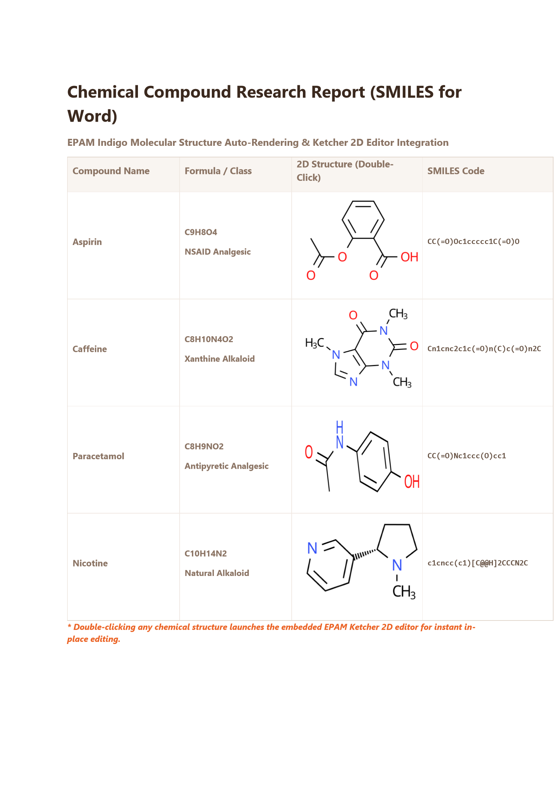
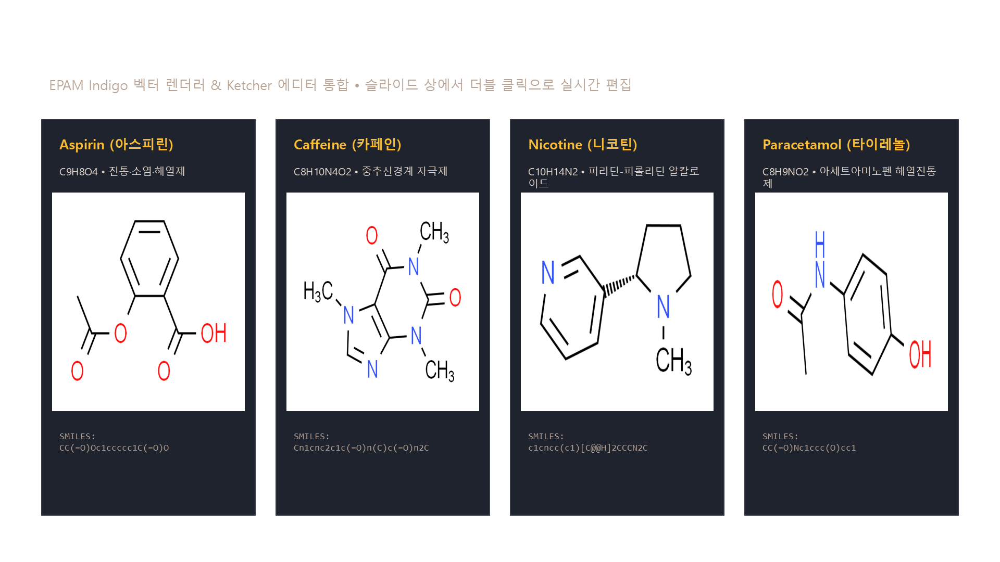
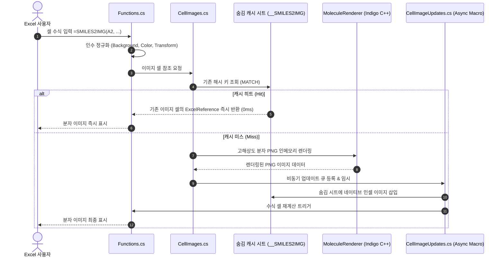

# SMILES for Microsoft Office Suite — 화학 분자 구조식 자동 렌더러 & 에디터 (Excel · Word · PowerPoint)

[English](README.md) | **한국어**

[-blue.svg)](#실행-요구사항)
[](https://dotnet.microsoft.com/)
[](https://excel-dna.net/)
[](https://lifescience.opensource.epam.com/indigo/)
[](https://lifescience.opensource.epam.com/ketcher/)
[](#-빠른-시작-설치-방법)

> **SMILES 화학 구조식 문자열을 Microsoft Office(Excel, Word, PowerPoint)에 고해상도 분자 이미지로 즉시 삽입하고, 내장된 Ketcher 웹 에디터로 자유롭게 그리고 수정할 수 있는 통합 오피스 추가 기능(Office Suite Add-in)입니다.**  
> 외부 웹 서버나 클라우드 전송 없이, PC 로컬에서 100% 오프라인으로 안전하고 빠르게 렌더링되며 관리자 권한(Admin) 없이 간편하게 설치됩니다.

<p align="center">
  
</p>

<p align="center">
  
  
</p>

---

## 📑 목차
- [✨ 지원 애플리케이션 및 주요 기능](#-지원-애플리케이션-및-주요-기능)
  - 📗 [Excel 사용법 가이드](docs/EXCEL_GUIDE.md)
  - 📘 [Word 사용법 가이드](docs/WORD_GUIDE.md)
  - 📙 [PowerPoint 사용법 가이드](docs/POWERPOINT_GUIDE.md)
- [🚀 빠른 시작 (통합 오피스 슈트 설치 방법)](#-빠른-시작-통합-오피스-슈트-설치-방법)
- [💡 Excel 사용 방법 및 수식 IntelliSense](#-excel-사용-방법-및-수식-intellisense)
- [📝 Word 및 PowerPoint 사용 방법](#-word-및-powerpoint-사용-방법)
- [📖 함수 구문 및 인자 규격 (Excel)](#-함수-구문-및-인자-규격-excel)
- [🎨 주요 활용 레시피 (실전 예시)](#-주요-활용-레시피-실전-예시)
- [🔬 화학 구조 렌더링 최적화 (ACS 저널 표준)](#-화학-구조-렌더링-최적화-acs-저널-표준)
- [🏗️ 내부 아키텍처 및 동작 원리](#️-내부-아키텍처-및-동작-원리)
- [📂 프로젝트 디렉터리 구조](#-프로젝트-디렉터리-구조)
- [🛠️ 빌드 및 배포 방법 (개발자용)](#️-빌드-및-배포-방법-개발자용)
- [🧪 자동화 테스트 및 검증](#-자동화-테스트-및-검증)
- [❓ 자주 묻는 질문 (FAQ)](#-자주-묻는-질문-faq)

---

## ✨ 지원 애플리케이션 및 주요 기능

| 애플리케이션 | 주요 기능 | 지원 방식 | 사용 가이드 |
| :--- | :--- | :--- | :---: |
| **Microsoft Excel** | • `=SMILES2IMG("CCO")` 네이티브 인셀 이미지 & `=SMILES2IMG.FLOAT("CCO")` 플로팅 그림<br>• **캔버스 구조식 삽입 (KET)**: 반응식, 화살표, 플러스 기호, 텍스트 주석이 포함된 캔버스 삽입<br>• **클립보드 즉시 삽입 / 분자 정보(화학식·분자량) 복사 / 우클릭 컨텍스트 메뉴**<br>• **셀 또는 캔버스 그림 더블 클릭 시 Ketcher 에디터 즉시 팝업 및 재편집** | Excel-DNA Standalone XLL (32/64비트) | 📗 [**Excel 가이드**](docs/EXCEL_GUIDE.md) |
| **Microsoft Word** | • 상단 리본 메뉴 **`[SMILES]`** 탭 & **우클릭 컨텍스트 메뉴** 제공<br>• **네이티브 KET 캔버스 저장**: 반응식, 화살표, 텍스트 주석, 복수 분자 2D 좌표 100% 보존<br>• **클립보드/선택 텍스트 즉시 삽입** & **SMILES / KET / 화학식·분자량(MW) 복사**<br>• **문서 내 분자 그림 더블 클릭 시 Ketcher 에디터로 즉시 불러와 제자리 수정** | Office COM Add-in (`.dll`, HKCU 무권한 등록) | 📘 [**Word 가이드**](docs/WORD_GUIDE.md) |
| **Microsoft PowerPoint** | • 상단 리본 메뉴 **`[SMILES]`** 탭 & **우클릭 컨텍스트 메뉴** 제공<br>• **네이티브 KET 캔버스 저장**: 고해상도 슬라이드 렌더링 및 **투명/흰색 배경 토글** 지원<br>• **클립보드 즉시 삽입** & **SMILES / KET / 화학식·분자량(MW) 복사**<br>• **슬라이드 분자 그림 더블 클릭 시 Ketcher 에디터로 즉시 불러와 크기·좌표 유지 수정** | Office COM Add-in (`.dll`, HKCU 무권한 등록) | 📙 [**PowerPoint 가이드**](docs/POWERPOINT_GUIDE.md) |

<br>

<p align="center">
  
</p>

---

## 🚀 빠른 시작 (설치 방법)

### 실행 요구사항

| 항목 | 필요한 환경 |
| :--- | :--- |
| Windows | Windows 10 또는 11; Windows 11 권장 |
| Excel (인셀 이미지 모드) | 네이티브 셀 내 이미지 기능을 지원하는 **Excel 2024 이상** 및 **Microsoft 365 데스크톱** (`=SMILES2IMG`) |
| Excel (플로팅 이미지 모드) | 셀 크기에 연동되는 플로팅 그림을 지원하는 **Excel 2016, 2019, 2021** (`=SMILES2IMG.FLOAT`) |
| 런타임 | **.NET Framework 4.8 이상** |
| Excel 비트수 | **32비트·64비트 모두** 배포 파일 제공; Excel 비트수에 맞는 XLL 선택 |

**하나의 XLL 파일로 Excel 2016부터 최신 Microsoft 365까지 모두 지원합니다:**
* **Excel 2024 / Microsoft 365:** `=SMILES2IMG(A2)`를 사용하면 Excel의 네이티브 '셀에 그림 배치' 기능으로 셀 안에 이미지가 쏙 들어갑니다.
* **Excel 2016 / 2019 / 2021:** 인셀 이미지를 미지원하는 구버전에서는 `=SMILES2IMG.FLOAT(A2)`를 사용합니다. 셀 위에 분자 그림이 배치되며, 셀 이동 및 행/열 크기 변경에 연동(`xlMoveAndSize`)됩니다. 만약 구버전에서 실수로 `SMILES2IMG`를 호출하더라도 오류 대신 `Needs Excel 2024/365: use SMILES2IMG.FLOAT`라는 친절한 안내 문구가 표시됩니다.
* 이 추가 기능은 Windows 데스크톱 Excel 전용이며, Mac용 Excel과 웹용 Excel에서는 XLL을 로드할 수 없습니다. 다운로드한 XLL을 사용하기 위해 개발용 **.NET SDK를 설치할 필요는 없습니다.**

### ⚡ 방법 A: 원클릭 자동 설치 및 업데이트 (가장 추천)

PowerShell을 열고 아래 명령어 **한 줄만 실행**하면 Microsoft Office 전체(Excel, Word, PowerPoint)에 대한 설치, 보안 해제, 레지스트리 등록이 모두 자동으로 완료됩니다:

```powershell
irm https://raw.githubusercontent.com/naramdash/func_SMILES2IMG/main/install.ps1 | iex
```

> **스크립트가 자동으로 처리하는 내용:**  
> 1. 내 Office 비트수(32비트 vs 64비트) 및 설치된 프로그램(Excel, Word, PowerPoint) 자동 감지  
> 2. `%APPDATA%\Microsoft\AddIns\Smiles2Img` 안전 폴더로 통합 오피스 슈트(Excel XLL, Word COM DLL, PowerPoint COM DLL) 자동 다운로드 및 배치  
> 3. Windows 보안 차단(`Unblock-File`) 일괄 자동 해제  
> 4. Excel, Word, PowerPoint 레지스트리 자동 등록 (관리자 권한 불필요, 실행 시 자동 로드)  
> 💡 **최신 버전 업데이트:** 이미 설치되어 있는 상태에서 위 명령어를 다시 실행하면, 최신 버전으로 안전하게 자동 업데이트됩니다.  
> 🗑️ **삭제 방법:** 언제든 PowerShell에서 `irm https://raw.githubusercontent.com/naramdash/func_SMILES2IMG/main/uninstall.ps1 | iex`를 실행하면 모든 파일과 등록 정보가 깔끔하게 제거됩니다.

> [!IMPORTANT]
> **Windows 11「스마트 앱 컨트롤 (Smart App Control)」관련 안내**  
> 엑셀 실행 시 `#NAME?` 오류가 발생하거나 `'Smiles2Img-AddIn64-packed.xll의 파일 형식 및 확장명이 일치하지 않습니다'`라는 보안 경고가 나타난다면, Windows 11의 **스마트 앱 컨트롤 (Smart App Control)**이 오픈소스 추가 기능을 차단한 것입니다.  
> 👉 파일이 깨진 것이 아니며, **[자주 묻는 질문(FAQ)](#-자주-묻는-질문-faq)**의 안내에 따라 **스마트 앱 컨트롤**을 **'꺼짐(Off)'**으로 설정하시면 즉시 정상 작동합니다. (실시간 바이러스 백신 감시는 100% 안전하게 유지됩니다)

---

### 🖐️ 방법 B: 수동 설치 (단계별 안내)

#### 1단계: 내 Office 비트수(32비트 vs 64비트) 확인
1. Excel, Word 또는 PowerPoint 실행 후 **[파일] → [계정] → [Excel / Word / PowerPoint 정보]** 클릭
2. 팝업 창 첫 줄 끝부분에서 **`32비트`** 또는 **`64비트`** 확인

#### 2단계: 배포 파일 다운로드
[GitHub Releases](https://github.com/naramdash/func_SMILES2IMG/releases/latest) 페이지에서 용도에 맞는 파일을 선택합니다:
* **선택 1 (통합 오피스 슈트 전체 — Excel, Word, PowerPoint):**  
  [**`Smiles2Img-Office-x64.zip`**](https://github.com/naramdash/func_SMILES2IMG/releases/latest/download/Smiles2Img-Office-x64.zip) (또는 [**`x86.zip`**](https://github.com/naramdash/func_SMILES2IMG/releases/latest/download/Smiles2Img-Office-x86.zip))을 다운로드하여 `%APPDATA%\Microsoft\AddIns\Smiles2Img`에 압축 해제 후 `install.ps1`을 실행합니다.
* **선택 2 (Excel 전용 단독 XLL):**  
  [**`Smiles2Img-AddIn64-packed.xll`**](https://github.com/naramdash/func_SMILES2IMG/releases/latest/download/Smiles2Img-AddIn64-packed.xll) (또는 [**`Smiles2Img-AddIn-packed.xll`**](https://github.com/naramdash/func_SMILES2IMG/releases/latest/download/Smiles2Img-AddIn-packed.xll)) 다운로드 후 `%APPDATA%\Microsoft\AddIns` 폴더에 복사합니다.

> [!TIP]
> **Windows 보안 차단 해제 (필수):**  
> 웹에서 다운로드한 파일은 Windows가 인터넷 꼬리표(`Mark of the Web`)를 붙여 실행을 차단합니다.  
> 다운로드한 파일 우클릭 → **[속성]** → 하단 보안 항목의 **[차단 해제(Unblock)]** 체크 후 **[확인]**을 눌러주세요.

#### 3단계: Excel에 추가 기능으로 등록 (단독 XLL의 경우)
1. Excel 메뉴에서 **[파일] → [옵션] → [추가 기능]** 이동
2. 창 하단 **[관리: Excel 추가 기능]** 옆의 **[이동(G)...]** 버튼 클릭
3. **[찾아보기(B)...]**를 눌러 다운로드한 XLL 파일 선택
4. 목록에 `Smiles2Img-AddIn`이 체크된 것을 확인하고 **[확인]** 클릭

---

## 💡 Excel 사용 방법 및 수식 IntelliSense
 
Excel 워크시트의 셀에 수식을 입력하면 즉시 분자 이미지가 삽입됩니다:
* **Excel 2024 / M365 (네이티브 인셀):** `=SMILES2IMG(A2)` 또는 `=KET2IMG(A2)`
* **Excel 2016 / 2019 / 2021 (셀 연동 플로팅):** `=SMILES2IMG.FLOAT(A2)` 또는 `=KET2IMG.FLOAT(A2)`
 
```excel
=SMILES2IMG(A2)
=SMILES2IMG.FLOAT(A2)
=KET2IMG(A2)
=KET2IMG.FLOAT(A2)
```
 
```text
=SMILES2IMG(
┌────────────────────────────────────────────────────────────────────────────────────────┐
│ SMILES2IMG(smiles, [background], [style], [transform])                                 │
│ [Excel 2024 / Microsoft 365] Renders a high-resolution molecular structure image...   │
└────────────────────────────────────────────────────────────────────────────────────────┘

=SMILES2IMG.FLOAT(
┌────────────────────────────────────────────────────────────────────────────────────────┐
│ SMILES2IMG.FLOAT(smiles, [background], [style], [transform])                           │
│ [Excel 2016+] Places a molecular structure picture over the cell (moves/sizes)...      │
└────────────────────────────────────────────────────────────────────────────────────────┘

=KET2IMG(
┌────────────────────────────────────────────────────────────────────────────────────────┐
│ KET2IMG(ket, [background], [style], [transform])                                       │
│ [Excel 2024 / Microsoft 365] Renders native Ketcher KET canvas format in-cell...      │
└────────────────────────────────────────────────────────────────────────────────────────┘

=KET2IMG.FLOAT(
┌────────────────────────────────────────────────────────────────────────────────────────┐
│ KET2IMG.FLOAT(ket, [background], [style], [transform])                                 │
│ [Excel 2016+] Places a Ketcher KET canvas picture over the cell (moves/sizes)...       │
└────────────────────────────────────────────────────────────────────────────────────────┘
```
 
> [!TIP]
> • **실시간 수식 툴팁 (ExcelDna.IntelliSense 내장):** 수식을 타이핑하면 엑셀 기본 내장 함수와 동일하게 지원 버전 및 현재 입력 중인 인자가 **굵은 글씨**로 강조되며 풍선도움말이 표시됩니다.  
> • **Ketcher 네이티브 KET 셀 수식 지원 (`=KET2IMG`):** 반응 화살표, 플러스(`+`), 복수 분자, 좌표, 텍스트가 포함된 원본 Ketcher 캔버스 데이터를 셀에 보존하고 `=KET2IMG(A2)`로 인셀 이미지화할 수 있습니다. 수식 셀을 더블 클릭하면 원본 반응식 그대로 Ketcher가 열려 수정 후 적용 시 셀 값이 동기화됩니다! *(참고: `=SMILES2IMG(A2)` 또한 KET 포맷을 자동 감지하여 렌더링합니다).*  
> • **행/열 크기 연동 (FLOAT 모드):** `SMILES2IMG.FLOAT`로 생성된 이미지는 셀과 함께 크기가 조절(`xlMoveAndSize`)됩니다. 만약 행 높이나 열 너비를 크게 변경한 후 비율을 원래대로 깔끔하게 맞추고 싶다면, 리본 메뉴의 **[SMILES] → [Refit floating images]**를 누르면 활성 시트의 모든 분자 그림이 셀 중앙에 완벽한 종횡비로 자동 재배치됩니다.  
> • **가독성 최적화:** 분자 구조의 미세 결합선이 선명하게 보이도록 행 높이(예: 80~120pt)와 열 너비(예: 25~40)를 넉넉하게 늘려주시는 것을 권장합니다.  
> • **🧬 EPAM Ketcher 내장 분자 구조식 편집기 (셀 수식 & KET 캔버스 모드):**  
>   - **셀 수식 모드 (`=SMILES2IMG`):** 빈 셀을 마우스 우클릭하고 **`[분자 구조식 삽입 (셀 수식)...]`**를 클릭하거나 **`Ctrl+Shift+K`**를 누르면 EPAM Ketcher 분자 에디터가 열립니다. 구조를 그리고 **[적용 (Ctrl+Enter)]**을 누르면 셀 자체가 `=SMILES2IMG("...")` 형태의 **인셀 분자 이미지 셀(Structure Cell)**로 즉시 변환됩니다.  
>   - **캔버스 구조식 모드 (`KET`):** 리본 탭이나 우클릭 메뉴에서 **`[캔버스 구조식 삽입]`**을 선택하면 반응 화살표, 플러스(`+`), 텍스트 레이블, 복수 분자가 포함된 전체 캔버스를 시트 위에 삽입하고 네이티브 `KET` 포맷으로 보존합니다.  
>   - **클립보드 즉시 삽입 & 분자 정보 복사:** **`[클립보드 즉시 삽입]`**으로 에디터를 열지 않고 복사된 SMILES/KET를 즉시 삽입하거나, **`[분자 정보 복사]`**로 화학식(Formula), 분자량(MW), 정밀 질량(Exact Mass)을 계산해 복사할 수 있습니다.  
>   - **더블 클릭 & 우클릭 컨텍스트 메뉴:** 수식 셀이나 캔버스 이미지를 언제든 **더블 클릭** 또는 **우클릭**하여 구조식 재편집, SMILES 추출, KET 데이터 복사, 분자량 확인이 가능합니다.  
>   - **오프라인 동작:** 외부 통신이나 로컬 HTTP 서버 포트 개방 없이 WebView2의 가상 호스트 매핑 기술로 **100% 안전하게 오프라인에서 구동**됩니다.  
>  
> 👉 **모든 인자 옵션과 상세 실전 레시피는 [docs/EXCEL_GUIDE.md](docs/EXCEL_GUIDE.md) 가이드에서 확인하실 수 있습니다.**

---

## 📝 Word 및 PowerPoint 사용 방법

Word와 PowerPoint에서도 Excel과 동일한 고품질 화학 구조식 렌더링 엔진(EPAM Indigo)과 2D 에디터(EPAM Ketcher)가 상단 리본 메뉴 및 마우스 우클릭 컨텍스트 메뉴에 완벽히 통합됩니다.

### 1. 상단 리본 메뉴 (`[SMILES]` 탭) & 마우스 우클릭 메뉴
Office 프로그램을 실행하면 리본 맨 끝에 **`[SMILES]`** 탭이 생성되며, 분자 이미지를 우클릭했을 때도 전용 메뉴가 표시됩니다:
* **[분자 구조식 삽입]**: 100% 오프라인 Ketcher 분자 에디터 창이 팝업됩니다. 분자, 반응식, 화살표, 텍스트 주석을 자유롭게 그리고 상단 바에서 **[배경: 투명 / 흰색]**을 선택한 뒤 **`Ctrl+Enter`**를 누르면 고해상도 PNG로 문서/슬라이드에 삽입됩니다.
* **[클립보드 즉시 삽입]**: 논문이나 웹에서 복사한 SMILES/KET 문자열(또는 문서 내 드래그하여 선택한 SMILES 텍스트)을 에디터 실행 없이 **0.1초 만에** 즉시 구조식 이미지로 변환하여 삽입합니다.
* **[구조식 편집]**: 선택된 분자 이미지의 전체 캔버스(`KET`) 또는 `SMILES`를 Ketcher 에디터로 다시 불러와 수정합니다.
* **[SMILES 복사] & [분자 정보 복사]**: 선택된 구조식에서 표준 SMILES를 추출하거나, **화학식(Formula), 분자량(MW, g/mol), 정밀 질량(Exact Mass)**을 계산하여 화면에 표시하고 클립보드에 복사합니다.

### 2. 그림 더블 클릭 원클릭 편집 (Double-Click to Edit)
* **Word**: 문서 내에 삽입된 분자 그림을 마우스로 **더블 클릭**하면 Ketcher 에디터가 즉시 열립니다. 구조를 수정하고 적용하면 기존 위치와 크기를 유지하며 수정된 구조식으로 즉시 교체됩니다.
* **PowerPoint**: 슬라이드 상의 분자 그림을 마우스로 **더블 클릭**하면(기본 그림 서식 창 대신) Ketcher 에디터가 즉시 열려 수정할 수 있으며, 기존 크기, 위치, 종횡비를 완벽히 유지하며 교체됩니다.

### 3. 무손실 KET 캔버스 & SMILES 메타데이터 보존
* 삽입된 모든 그림의 개체 속성(`AlternativeText`, `Title`, `Tags`)에 Ketcher 네이티브 **`KET:{...}` 캔버스 전체 데이터**와 **`SMILES:...` 문자열**이 무손실로 안전하게 보존되므로, 문서를 저장하고 다른 사람에게 공유하거나 나중에 다시 열어도 반응 화살표, 복수 분자 배치, 텍스트 주석까지 100% 그대로 복원하고 편집할 수 있습니다.

> 📚 **애플리케이션별 상세 가이드:**  
> • 📘 [**Word 사용법 상세 가이드 (docs/WORD_GUIDE.md)**](docs/WORD_GUIDE.md): 표 서식, 보고서 레이아웃, 인쇄 및 고해상도 PDF 변환 팁.  
> • 📙 [**PowerPoint 사용법 상세 가이드 (docs/POWERPOINT_GUIDE.md)**](docs/POWERPOINT_GUIDE.md): 카드형 슬라이드 레이아웃, 반응식 작성, 다크 테마 발표 팁.

---
 
## 📖 함수 구문 및 인자 규격
 
```excel
=SMILES2IMG(smiles, [background], [style], [transform])
=SMILES2IMG.FLOAT(smiles, [background], [style], [transform])
=KET2IMG(ket, [background], [style], [transform])
=KET2IMG.FLOAT(ket, [background], [style], [transform])
```
 
*(모든 함수는 동일한 스타일 및 변환 인자 규격을 공유합니다.)*

| 순서 | 인자명 | 타입 | 필수 여부 | 기본값 | 허용 값 및 세부 설명 |
| :---: | :--- | :---: | :---: | :---: | :--- |
| **1** | **`smiles` / `ket`** | 문자열 | **필수** | - | 분자 SMILES 문자열(예: `"CCO"`) 또는 Ketcher 네이티브 KET JSON 포맷 문자열(`KET:{...}` 또는 `{...}`), 또는 해당 데이터가 있는 참조 셀(`A2`) |
| **2** | **`background`** | 문자열 | 선택 | `"trans"` | **배경 캔버스 스타일 설정 (대소문자 무관):**<br>• `"trans"`, `"transparent"`, `"nobg"`: 셀 채우기 색상/표 줄무늬가 그대로 비치는 투명 캔버스 (기본값)<br>• `"white"`: 흰색 불투명 캔버스 배경<br>• CSS 색상명: `"yellow"`, `"lightblue"`, `"lightgray"`, `"aliceblue"`, `"cornsilk"`, `"pink"` 등 140+ CSS 표준 색상명<br>• 16진수 색상: `"#FFFF00"` 또는 `"FFFF00"` 등 3/6자리 Hex 색상 |
| **3** | **`style`** | 문자열 / 불리언 | 선택 | `"color"` | **화학 도메인 렌더링 스타일 & 복합 옵션 (띄어쓰기 또는 파이프 `|` 결합):**<br>• **단일 스타일 토큰:**<br>  - 원소 기본 컬러: `"color"`, `"cpk"`, `TRUE`, `1` *(기본값: 산소=빨강, 질소=파랑, 황=황갈색 등)*<br>  - 흑백 단색 선화: `"bw"`, `"mono"`, `"black"`, `FALSE`, `0` *(특허청 KIPO/USPTO 출원 및 학술지 인쇄)*<br>  - 원자 번호 표기: `"num"`, `"idx"`, `"number"` *(NMR chemical shift 피크 귀속 및 메커니즘용 1, 2, 3...)*<br>  - 입체화학 라벨: `"stereo"`, `"chiral"`, `"ext"` *(비대칭 탄소 R/S, 이중결합 E/Z 절대배열 라벨)*<br>  - 모든 수소 전개: `"h"`, `"hydrogens"`, `"unfoldh"` *(입체 장애 및 활성 수소 확인용 C-H 결합선 전개)*<br>  - 골격 탄소 기호: `"all-c"`, `"carbon"` *(생략선 대신 모든 꺾임점에 문자 "C" 명시)*<br>  - 다크모드 잉크: `"white"`, `"light"` *(어두운 배경 시트 발표용 선명한 순백색 결합선)*<br>  - 커스텀 잉크: `"ink=#RRGGBB"`, `"ink=navy"` *(기업 CI/브랜드 테마 결합선 색상)*<br>• **스트링 조합 예제 (공백 또는 파이프 `|` 사용):**<br>  - 특허용 흑백 번호 도면: `"bw num"` *(또는 `"bw|num"`)*<br>  - 학술지용 단색 입체식: `"bw stereo"` *(또는 `"bw|stereo"`)*<br>  - 반응 메커니즘 추적: `"num h"` *(또는 `"num|h"`)*<br>  - 다크모드 입체 구조: `"white stereo"` *(또는 `"white|stereo"`)*<br>  - 다크모드 복합 전개: `"white stereo num h"`<br>• **⭐ 모든 옵션을 다 썼을 때의 풀옵션 스트링 예제:**<br>  - `"bw num stereo h all-c"`<br>  - *(또는 파이프 버전: `"bw|num|stereo|h|all-c"`)* |
| **4** | **`transform`** | 문자열 | 선택 | `""` | **2D 좌표 기하학적 변환 (대소문자 무관, 공백으로 복합 결합 가능):**<br>• `flip`: 좌우 반전 (교과서/화학 DB 표준 고리 배치로 전환)<br>• `flipy`: 상하 반전<br>• `rot90`, `rot180`, `rot270`: 시계 방향 90° 단위 회전<br>• **복합 변환 예시:** `"flip rot90"` (좌우 반전 후 90도 회전), `"rot180"` |

> [!TIP]
> • **⭐ 모든 옵션을 총망라한 '풀옵션 수식' (The Ultimate Full-Option Formula):**  
>   `=SMILES2IMG(A2, "white", "bw num stereo h all-c", "flip rot90")`  
>   *(또는 파이프 구분자: `=SMILES2IMG(A2, "white", "bw|num|stereo|h|all-c", "flip rot90")`)*  
>   불투명 흰색 캔버스 + 100% 흑백 단색화 + 원자 일련번호(1, 2, 3...) + 키랄 입체배열(R/S) + 모든 수소(H) 전개 + 골격 탄소(C) 명시 + 교과서 표준 좌우 반전 + 90도 회전까지 모든 기능이 결합된 종합 수식입니다!  
> • **띄어쓰기 vs. 파이프 (스타일 결합 추천):** 엑셀 수식의 인자 구분 쉼표와 시각적으로 헷갈리지 않도록 스타일 옵션 결합 시에는 **띄어쓰기(공백)**(`"bw num"`, `"white stereo"`) 또는 **파이프(`|`)**(`"bw|num"`, `"white|stereo"`)를 사용하시는 것을 강력 권장합니다. (기존 쉼표 `"bw,num"`도 100% 호환).  
> • **앞쪽 인자 생략법:** 앞쪽 인자를 기본값(투명 캔버스)으로 유지한 채 뒤쪽 옵션만 주고 싶다면 쉼표를 연속(` , , `)으로 입력합니다 (예: `=SMILES2IMG(A2, , "bw")` 또는 `=SMILES2IMG(A2, , , "flip")`).  
> • **기존 수식 100% 하위 호환:** 3번째 인자에 기존처럼 불리언 `TRUE`/`FALSE`나 숫자 `1`/`0`을 넘기셔도 완벽하게 지원됩니다.

---

## 🎨 주요 활용 레시피 (실전 예시)

<p align="center">
  
</p>

| 분류 | 활용 목적 / 상황 | 추천 수식 작성 예시 | 설명 |
| :--- | :--- | :--- | :--- |
| **⭐ 종합 풀옵션** | **궁극의 풀옵션 수식 (All-in-One)** | `=SMILES2IMG(A2, "white", "bw num stereo h all-c", "flip rot90")` | 전 기능 총망라: 흰색 캔버스 + 흑백 + 원자번호 + 입체라벨 + 수소전개 + 탄소기호 + 반전 + 90도 회전 |
| **⭐ 종합 풀옵션** | **다크모드 풀옵션 완성형** | `=SMILES2IMG(A2, "#1a1a1a", "white stereo num h", "flip")` | 다크 캔버스 + 순백색 선화 + 입체라벨 + 원자번호 + 수소전개 + 좌우 반전 |
| **기본 활용** | **셀 참조 전달** | `=SMILES2IMG(A2)` | 표준 투명 배경 + 원소별 고유 CPK 컬러 렌더링 |
| **기본 활용** | **SMILES 직접 입력** | `=SMILES2IMG("CC(=O)Oc1ccccc1C(=O)O")` | 외부 셀 참조 없이 아스피린 분자식을 수식에 직접 전달 |
| **특허 및 논문** | **특허청 출원 도면 (B/W)** | `=SMILES2IMG(A2, , "bw")` | 특허청(KIPO/USPTO) 선화(Line Art) 규격 100% 흑백 단색 출력 |
| **특허 및 논문** | **특허용 원자 번호 도면** | `=SMILES2IMG(A2, , "bw num")` | 청구항 및 명세서 설명용 원자 번호(1, 2, 3...) 첨자 명시 흑백 도면 |
| **특허 및 논문** | **저널 게재용 입체식** | `=SMILES2IMG(A2, , "bw stereo")` | 저널 본문 흑백 인쇄 규격 + 키랄 중심 R/S 및 E/Z 입체배열 표기 |
| **특허 및 논문** | **특허 명세서 완성형 규격** | `=SMILES2IMG(A2, "white", "bw num stereo")` | 불투명 순백 캔버스 + 흑백 + 원자 번호 + 입체배열 라벨 완전 결합 |
| **분광학 및 메커니즘** | **NMR 피크 귀속 번호** | `=SMILES2IMG(A2, , "num")` | ¹H / ¹³C NMR chemical shift (ppm) 스펙트럼 피크 귀속용 원자 번호 |
| **분광학 및 메커니즘** | **키랄 R/S 및 기하 E/Z** | `=SMILES2IMG(A2, , "stereo")` | 비대칭 중심과 이중결합의 입체화학 라벨을 구조식 위에 명시 |
| **분광학 및 메커니즘** | **입체장애 / 활성수소 전개** | `=SMILES2IMG(A2, , "h")` | 입체 장애(Steric Hindrance) 및 양성자 교환 사이트 확인용 모든 C-H 결합선 전개 |
| **분광학 및 메커니즘** | **반응 메커니즘 추적** | `=SMILES2IMG(A2, , "num h")` | 전자 이동 곡선 화살표 표기 및 원자 추적용 (원자 번호 + 수소 전개) |
| **교육 및 구조 명확화** | **골격 탄소 기호 명시** | `=SMILES2IMG(A2, , "all-c")` | 생략선 꺾임점마다 문자 "C"를 명시 (기초 유기화학 강의 및 입문용) |
| **교육 및 구조 명확화** | **탄소 기호 + 원자 번호** | `=SMILES2IMG(A2, , "all-c num")` | 모든 탄소 기호 표기 및 순차적 원자 번호 동시 명시 |
| **다크 테마 & 디자인** | **다크 테마 프레젠테이션** | `=SMILES2IMG(A2, "#1e1e1e", "white")` | 어두운 셀 배경 + 순백색 분자 결합선 (높은 대비의 깔끔한 프레젠테이션) |
| **다크 테마 & 디자인** | **다크모드 + 입체라벨** | `=SMILES2IMG(A2, "#202020", "white stereo")` | 다크 테마 배경 + 순백색 분자선 + 입체배열(R/S) 라벨 |
| **다크 테마 & 디자인** | **기업/브랜드 전용 잉크** | `=SMILES2IMG(A2, "aliceblue", "ink=#003366")` | 회사 CI 네이비 컬러 결합선 잉크 + 은은한 라이트블루 배경 |
| **다크 테마 & 디자인** | **위험/주요 물질 강조 셀** | `=SMILES2IMG(A2, "#FFF9C4", "bw num")` | 연노랑 경고 셀 채우기 + 흑백 번호 표기 구조식 |
| **방향 및 정렬 조정** | **교과서 표준 좌우 반전** | `=SMILES2IMG(A2, , , "flip")` | 니코틴, 티아민 등 교과서나 화학식 DB 표준 방향으로 좌우 반전 |
| **방향 및 정렬 조정** | **상하 반전** | `=SMILES2IMG(A2, , , "flipy")` | 2D 평면 상하 반전 |
| **방향 및 정렬 조정** | **긴 사슬 90도 회전** | `=SMILES2IMG(A2, , , "rot90")` | 세로로 긴 분자를 좁은 열 너비에 맞게 90도 시계방향 회전 |
| **방향 및 정렬 조정** | **180도 회전** | `=SMILES2IMG(A2, , , "rot180")` | 상하좌우 완전 반전 |
| **다중 복합 지정** | **흰 배경 + 흑백 + 반전** | `=SMILES2IMG(A2, "white", "bw", "flip")` | 흰색 캔버스 + 단색 잉크 + 좌우 반전 조합 |
| **캔버스 반응식 (KET)** | **인셀 화학 반응식 삽입** | `=KET2IMG(A2)` | Ketcher 반응식, 화살표, 텍스트가 포함된 KET 데이터를 인셀 이미지로 렌더링 |
| **캔버스 반응식 (KET)** | **플로팅 화학 반응식 삽입** | `=KET2IMG.FLOAT(A2)` | 구버전 호환 셀 연동 플로팅 반응식 이미지 삽입 |
| **구버전 호환 (FLOAT 모드)**| **구버전 플로팅 이미지 기본** | `=SMILES2IMG.FLOAT(A2)` | Excel 2016, 2019, 2021 환경에서 셀 연동 플로팅 그림 삽입 (`xlMoveAndSize`) |
| **구버전 호환 (FLOAT 모드)**| **구버전 특허 도면 렌더링** | `=SMILES2IMG.FLOAT(A2, , "bw num")` | 구버전 엑셀에서 특허용 흑백 번호 도면 배치 |
| **구버전 호환 (FLOAT 모드)**| **구버전 다크모드 렌더링** | `=SMILES2IMG.FLOAT(A2, "#1e1e1e", "white stereo")` | 구버전 엑셀에서 다크 배경 및 흰색 분자선 배치 |

---

## 🔬 화학 구조 렌더링 최적화 (ACS 저널 표준)

화학자 및 국제 저널(ACS, IUPAC)이 선호하는 시각적 완성도를 제공하기 위해 다음 최적화 파이프라인이 적용되어 있습니다:


1. **가변 고해상도 벡터급 렌더링 (Dynamic Resolution):**  
   고정 캔버스 크기 대신 결합 길이(Bond Length: 80px), 여백(Margins: 30px), 선 상대 두께(Relative Thickness: 1.5) 기반 가변 해상도를 적용하여 분자 크기와 무관하게 모든 화합물이 균일한 선 굵기와 비율로 렌더링됩니다.
2. **Kekulé 표기법 자동 전환 (`dearomatize`):**  
   벤젠 고리 등의 어색한 점선 원형(Aromatic circle) 대신 유기화학 논문 표준인 교대 이중결합(Kekulé form)으로 명확히 표현합니다 (`aromaticity-model = generic`).
3. **고리 접합부/가교 키랄 수소(H) 선별 보존 (`ExposeRingJunctionChiralHydrogens`):**  
   다환계 접합부(Ring Junction, 예: 아플라톡신, 베르게닌)에서 결합선 겹침을 방지하고 입체 배치를 명확히 하기 위해 접합부 키랄 수소를 선별적으로 보존합니다 (α-투존 등 3원환 내부 결합 왜곡 방지 포함).
4. **헤테로원자 결합 메틸기 및 소형 분자 가독성 개선:**  
   - 초소형 분자(MIC `CN=C=O`, 메탄올 `CO`, 에탄올 등)는 단순 빗금 대신 화학 표준 텍스트(`H₃C-N=C=O`, `H₃C-OH`)로 명시합니다.
   - N/O/S에 결합된 메틸기를 자동 식별하여 `N-CH₃`, `H₃C-O-` 등으로 표기하며, 카로틴 등 순수 탄화수소 사슬은 골격선으로 유지합니다.
5. **스마트 수평 레이아웃 (`smart-layout` + `layout-orientation: horizontal`):**  
   티아민, 니코틴처럼 두 고리가 연결된 구조의 가교 결합을 반듯한 수평으로 정렬하고 가로가 긴 엑셀 셀 종횡비에 최적화합니다.
6. **황(S) 원자 시인성 최적화:**  
   흰 배경에서 눈이 부신 형광 노랑 대신 다크 골든로드/황갈색(`#A88013`)으로 렌더링되어 높은 가독성을 제공합니다.
7. **투명 배경 및 커스텀 배경색 완벽 지원:**  
   알파 채널(Alpha=0) 투명 배경과 16진수 색상 배경을 완벽하게 지원합니다.

---

## 🏗️ 내부 아키텍처 및 동작 원리



- **100% 인메모리 오프라인 실행:** Node.js, WebView2, 외부 HTTP 웹 API 통신 없이 로컬 인메모리 프로세스 안에서 순수하게 처리됩니다.
- **스마트 캐싱 및 시트 무결성:** 워크시트 내 숨겨진 `__SMILES2IMG` 캐시 시트를 통해 이미지를 재사용하므로 파일 저장 후 다시 열어도 이미지가 손실되지 않고 초고속으로 복원됩니다.

---

## 📂 프로젝트 디렉터리 구조

```text
func_SMILES2IMG/
├── Smiles2Img.sln                      # Visual Studio / .NET 통합 솔루션 파일
├── Directory.Build.props               # 공통 버전(1.4.0), 타깃 프레임워크(net48) 및 컴파일러 설정
├── src/
│   ├── Smiles2Img.Core/                # 공통 렌더링 및 에디터 코어 라이브러리 (net48)
│   │   ├── Rendering/                  # EPAM Indigo 1.49.0-rc.2 래퍼, ACS 표준 렌더러, 색상/옵션 파서
│   │   ├── Editor/                     # EPAM Ketcher v3.18.0 WebView2 Form, SHA256 에셋 관리자 & StructureMetadata
│   │   └── COM/                        # Office 공통 COM 인터페이스 (IDTExtensibility2, IRibbonExtensibility)
│   ├── Smiles2Img.Excel/               # Excel-DNA 독립형 XLL 추가 기능 (net48)
│   │   ├── Functions.cs                # =SMILES2IMG 인셀 함수 (Excel 2024 / M365)
│   │   ├── FloatFunctions.cs           # =SMILES2IMG.FLOAT 플로팅 함수 (Excel 2016-2021)
│   │   ├── CellImages.cs               # 인셀 이미지 캐시 관리
│   │   ├── FloatingPictures.cs         # 셀 크기 연동 플로팅 이미지 관리
│   │   ├── SmilesRibbon.cs             # [SMILES] 리본 탭 및 마우스 우클릭 컨텍스트 메뉴 핸들러
│   │   ├── KetcherEditor.cs            # Ketcher 명령, 클립보드 즉시 삽입, 분자 정보 복사 및 더블 클릭 훅
│   │   └── KetcherEditor.ShapesAndCells.cs # KET 캔버스 도형 및 수식 셀 추출/삽입 헬퍼
│   ├── Smiles2Img.Word/                # Word COM 추가 기능 DLL (net48)
│   │   ├── WordAddIn.cs                # IDTExtensibility2 + IRibbonExtensibility 구현체
│   │   └── WordStructureManager.cs     # 인라인 분자 그림 삽입, 교체, 즉시 삽입 및 더블 클릭 핸들러
│   └── Smiles2Img.PowerPoint/          # PowerPoint COM 추가 기능 DLL (net48)
│       ├── PowerPointAddIn.cs          # IDTExtensibility2 + IRibbonExtensibility + Win32 더블 클릭 훅
│       └── PowerPointStructureManager.cs # 슬라이드 분자 개체 삽입, 교체, 즉시 삽입 및 메타데이터 관리
├── dist/                               # 배포용 산출물 디렉터리
│   ├── x64/
│   │   ├── Smiles2Img-AddIn64-packed.xll # 64비트 Excel용 완전 독립형 XLL
│   │   ├── Word/                       # 64비트 Word COM 추가 기능 바이너리
│   │   ├── PowerPoint/                 # 64비트 PowerPoint COM 추가 기능 바이너리
│   │   └── Smiles2Img-Office-x64.zip   # 64비트 Office 슈트 배포용 아카이브
│   └── x86/
│       ├── Smiles2Img-AddIn-packed.xll   # 32비트 Excel용 완전 독립형 XLL
│       ├── Word/                       # 32비트 Word COM 추가 기능 바이너리
│       ├── PowerPoint/                 # 32비트 PowerPoint COM 추가 기능 바이너리
│       └── Smiles2Img-Office-x86.zip   # 32비트 Office 슈트 배포용 아카이브
├── tests/                              # 자동화 테스트 슈트
│   ├── Excel-Smoke.ps1                 # 실제 Excel COM 프로세스 구동 E2E 테스트
│   ├── Excel-365-FeatureTests.ps1      # Excel 365 실전 신규 스타일 및 풀옵션 통합 테스트
│   ├── Excel-DeepStressTests.ps1       # 대량 분자 동시 렌더링 스트레스 테스트
│   ├── Program.cs                      # 코어 단위 테스트 + 실제 WebView2/Ketcher v3.18.0 E2E 왕복 테스트
│   └── Smiles2Img.Tests.csproj
├── scripts/
│   ├── Test-OfficeE2E.ps1              # Word, PowerPoint, Excel 통합 COM 추가 기능 E2E 테스트 스크립트
│   ├── Package-Release.ps1             # 릴리스용 ZIP 아카이브 패키징 스크립트
│   └── Generate-Showcase-Workbook.ps1  # 쇼케이스 엑셀 워크북 생성기
├── install.ps1                         # Office Suite 통합 원클릭 설치 스크립트
├── uninstall.ps1                       # Office Suite 통합 제거 스크립트
├── THIRD_PARTY_NOTICES.md              # 오픈소스 라이선스 고지문
├── README.KR.md                        # 한국어 가이드 문서
└── README.md                           # 영문 기본 가이드 문서
```

---

## 🛠️ 빌드 및 배포 방법 (개발자용)

### 사전 요구사항
* Windows 10/11
* [.NET SDK 8.0 이상](https://dotnet.microsoft.com/) (.NET Framework 4.8 타깃 빌드)

### 전체 솔루션 빌드 명령어
프로젝트 루트 디렉터리에서 아래 명령어를 실행합니다:

```powershell
# 패키지 복원 및 전체 솔루션 릴리스 빌드 (Excel XLL 패킹 및 Word/PowerPoint 바이너리 포함)
dotnet build Smiles2Img.sln -c Release

# 릴리스 배포용 아카이브(ZIP) 생성
powershell -ExecutionPolicy Bypass -File scripts\Package-Release.ps1
```

빌드가 성공하면 `dist/x64/` 및 `dist/x86/`에 모든 C++ 네이티브 라이브러리와 IntelliSense가 압축 내장된 단일 `.xll` 파일이 생성됩니다.

---

## 🧪 자동화 테스트 및 검증

### 1. 코어 단위 테스트 + 실제 WebView2 Ketcher E2E 테스트 (Office 불필요)
화학 구조 렌더링, 수소 보존, 변환 매개변수, 투명 배경 픽셀 유효성, 분자 물리화학 정보(`Formula`, `MW`, `Exact Mass`) 및 실제 WebView2 + EPAM Ketcher v3.18.0 양방향 왕복(`SMILES` $\leftrightarrow$ `KET` + 투명/흰색 PNG 추출)을 검증합니다:

```powershell
dotnet build tests/Smiles2Img.Tests.csproj -c Release --no-restore --tl:off
& tests/bin/Release/net48/Smiles2Img.Tests.exe
```

### 2. 통합 Office Suite COM E2E 자동화 테스트 (Word + PowerPoint + Excel)
실제 **Microsoft Word, PowerPoint, Excel** 프로세스를 구동하여 COM 추가 기능 로드, `KET` + `SMILES` 메타데이터 보존(`AlternativeText`, `Title`, `Tags`), 종횡비 유지 제자리 교체, 수식 계산을 일괄 검증합니다:

```powershell
powershell -NoProfile -STA -ExecutionPolicy Bypass -File scripts/Test-OfficeE2E.ps1
```

### 3. Excel COM E2E 자동화 스모크 테스트 (실제 Excel 구동)
실제 Excel 인스턴스를 백그라운드로 띄워 전체 라이프사이클을 검증합니다:

```powershell
powershell -NoProfile -STA -ExecutionPolicy Bypass -File tests/Excel-Smoke.ps1
```
* XLL 추가 기능 등록 및 수식 인식 검증
* 인셀 이미지 자동 삽입 및 수식 유지 검증
* SMILES 수정 시 이미지 실시간 갱신 (중복/떠다니는 이미지 없음)
* 캐시 히트를 통한 즉각적인 다른 셀 재사용 검증
* 통합문서 저장, 재오픈 후 이미지 유지 검증
* 수식 셀 삭제 시 캐시 이미지 자동 정리 검증

### 4. Excel 365 실전 신규 기능 및 대량 스트레스 테스트
Excel Desktop 365 환경에서 신규 복합 스타일, 풀옵션 수식, 그리고 20개 이상의 분자 일괄 처리를 검증합니다:

```powershell
# 신규 기능 및 풀옵션 수식 통합 테스트
powershell -NoProfile -STA -ExecutionPolicy Bypass -File tests/Excel-365-FeatureTests.ps1

# 20개 복잡 분자 일괄 생성 및 엣지케이스 스트레스 테스트
powershell -NoProfile -STA -ExecutionPolicy Bypass -File tests/Excel-DeepStressTests.ps1
```

---

## ❓ 자주 묻는 질문 (FAQ)

* **Q. 내 Excel 버전에서 어떤 함수를 써야 하나요?**
  * **Microsoft 365 또는 Excel 2024 이상:** `=SMILES2IMG(...)`를 사용하시면 셀 안에 쏙 들어가는 네이티브 인셀 이미지가 생성됩니다.
  * **Excel 2016, 2019, 2021:** 인셀 이미지를 지원하지 않으므로 `=SMILES2IMG.FLOAT(...)`를 사용하세요. 셀 위에 떠 있지만 행 높이/열 너비 조절에 맞춰 자동으로 크기와 위치가 연동(`xlMoveAndSize`)됩니다. 만약 구버전에서 `SMILES2IMG`를 호출하더라도 에러 대신 `Needs Excel 2024/365: use SMILES2IMG.FLOAT`라는 친절한 안내가 셀에 표시됩니다.
* **Q. 수식 결과가 `#VALUE!`로 나옵니다. 화학식의 어디가 틀렸는지 어떻게 아나요?**
  * 참조한 셀에 올바른 SMILES 문자열이 들어있는지 확인하세요.
  * 참조 셀이 **셀 병합(Merged Cells)**되어 있다면 빈 셀이 참조되어 `#VALUE!`가 발생할 수 있습니다.
  * **💡 구체적인 화학식 오류 원인 확인법:** Excel 상단 리본 메뉴의 **[SMILES] ➔ [Show diagnostics]** 창을 여시면, 닫히지 않은 고리 번호(`cycle not closed`), 화학적 원자가 불일치(`invalid valence`), 미인식 원소 등 화학 엔진(Indigo)이 감지한 **정확한 오류 원인과 위치**를 실시간으로 확인하실 수 있습니다.
* **Q. Excel에서 XLL 추가 기능이 차단되거나 로드되지 않습니다.**
  * 웹에서 다운로드한 파일은 Windows가 보안 차단을 걸 수 있습니다. 다운로드한 `.xll` 파일을 우클릭하여 **[속성]** 창 하단의 **[차단 해제(Unblock)]**에 체크한 후 **[확인]**을 눌러주세요.
  * 가장 간편하게는 README 상단의 **원클릭 자동 설치 스크립트(방법 A)**를 실행하시면 보안 차단 해제부터 등록까지 100% 자동 처리됩니다.
* **Q. [스마트 앱 컨트롤] 엑셀을 열 때 "파일 형식 및 확장명이 일치하지 않습니다" 경고가 뜨거나 수식이 `#NAME?`으로 나옵니다.**
  * **원인:** 파일이 깨진 것이 아닙니다! Windows 11의 **'스마트 앱 컨트롤(Smart App Control)'**이 공인 기업 서명이 등록되지 않은 오픈소스 XLL 추가 기능을 로드하지 못하도록 차단했을 때 발생하는 현상입니다.
  * **안심하세요:** '스마트 앱 컨트롤'을 꺼도 **Windows Defender 기본 백신(실시간 바이러스 감시)은 100% 그대로 안전하게 작동**합니다.
  * **해결 방법 (10초 소요):**
    1. Windows **[설정]** (`Win + I`) ➔ **[개인 정보 및 보안]** ➔ **[Windows 보안]** 접속
    2. **[앱 및 브라우저 컨트롤]** ➔ **[스마트 앱 제어 설정]** 클릭
    3. 상태를 **'꺼짐(Off)'**으로 변경 후 엑셀을 재실행하시면 즉시 정상 작동합니다.
* **Q. 셀 이미지가 너무 작거나 축소되어 보입니다.**
  * 생성된 이미지는 엑셀 셀 크기에 맞춰 자동으로 종횡비가 유지되며 축척됩니다. 행 높이(예: 80~120pt)와 열 너비(예: 25~40)를 넉넉하게 늘려주시면 분자 결합선이 크고 선명하게 표시됩니다.
* **Q. 흑백 인쇄나 다크모드 시트에 어울리게 스타일을 바꾸고 싶습니다.**
  * 3번째 인자에 `"bw"`를 넣으시면 특허/학술지 규격 100% 흑백 선화로 출력됩니다.
  * 다크 테마 시트에서는 2번째 인자에 어두운 배경(`"#1a1a1a"`), 3번째 인자에 백색 잉크(`"white"`)를 넣으시면 깔끔한 다크모드 분자 구조식이 완성됩니다. (예: `=SMILES2IMG(A2, "#1a1a1a", "white")`)

