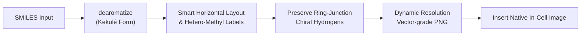
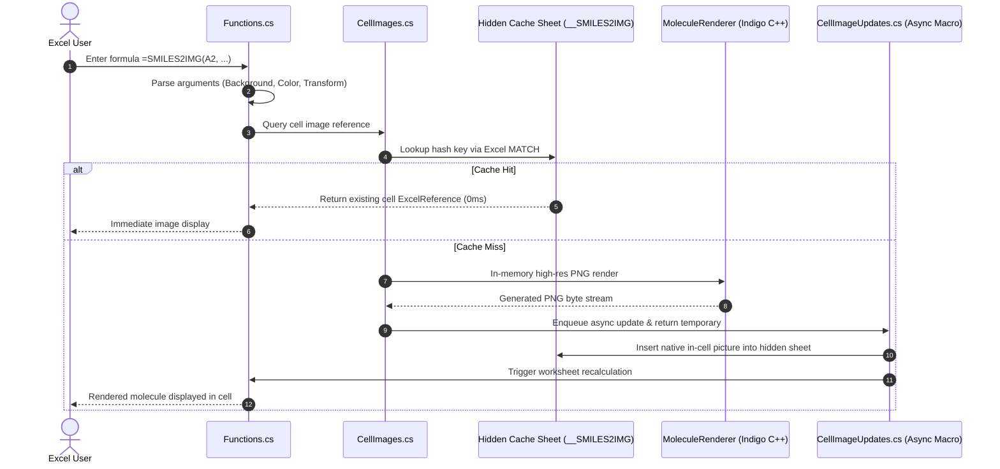

# SMILES for Microsoft Office Suite — Chemical Structure Renderer & Editor (Excel · Word · PowerPoint)

**English** | [한국어](README.KR.md)

[-blue.svg)](#runtime-requirements)
[](https://dotnet.microsoft.com/)
[](https://excel-dna.net/)
[](https://lifescience.opensource.epam.com/indigo/)
[](https://lifescience.opensource.epam.com/ketcher/)
[](#-quick-install)

---

## ⚡ Quick Install

Open **PowerShell** and run this single command to automatically install, configure security, and register the add-in across the entire Microsoft Office suite (Excel, Word, PowerPoint):

```powershell
irm https://raw.githubusercontent.com/naramdash/func_SMILES2IMG/main/install.ps1 | iex
```

> **What the installer automates:**  
> 1. Detects your Office bitness (32-bit vs. 64-bit) and installed Office applications (Excel, Word, PowerPoint)  
> 2. Downloads and places the unified suite (Excel XLL, Word COM DLL, PowerPoint COM DLL) in `%APPDATA%\Microsoft\AddIns\Smiles2Img`  
> 3. Unblocks files (`Unblock-File`) to remove Windows security flags automatically  
> 4. Registers Excel, Word, and PowerPoint add-ins in HKCU registry (no admin rights required, loads automatically on start)  
> 💡 **Future Updates:** Running this exact command again in the future automatically upgrades to the latest release!  
> 🗑️ **Uninstallation:** Run `irm https://raw.githubusercontent.com/naramdash/func_SMILES2IMG/main/uninstall.ps1 | iex` anytime to cleanly remove all files and registry entries.

> [!IMPORTANT]
> **Windows 11「Smart App Control」Notice**  
> If Excel displays `#NAME?` or warns that `'The file format and extension of Smiles2Img-AddIn64-packed.xll do not match'`, Windows 11 **Smart App Control** has blocked the unsigned XLL add-in.  
> 👉 The file is NOT corrupted. Follow the instructions in the **[FAQ section](#-frequently-asked-questions-faq)** to set **Smart App Control** to **'Off'**. (Real-time Microsoft Defender Antivirus protection remains 100% active).

---

> **A unified Microsoft Office add-in suite (Excel, Word, PowerPoint) that renders high-resolution 2D chemical structures directly from SMILES strings and provides interactive structure sketching via EPAM Ketcher.**  
> 100% local and offline execution without external web requests, cloud services, or administrative privileges.

<p align="center">
  
</p>

<p align="center">
  
  
</p>

---

## 📑 Table of Contents
- [⚡ Quick Install](#-quick-install)
- [✨ Supported Applications & Key Features](#-supported-applications--key-features)
  - 📗 [Excel User Guide](docs/EXCEL_GUIDE.md)
  - 📘 [Word User Guide](docs/WORD_GUIDE.md)
  - 📙 [PowerPoint User Guide](docs/POWERPOINT_GUIDE.md)
- [🎥 3-Minute Video Walkthroughs](#-3-minute-video-walkthroughs)
- [🚀 Detailed Installation & Requirements](#-detailed-installation--requirements)
- [💡 Excel Usage & Real-Time IntelliSense](#-excel-usage--real-time-intellisense)
- [📝 Word & PowerPoint Usage](#-word--powerpoint-usage)
- [📖 Function Syntax & Parameter Specification (Excel)](#-function-syntax--parameter-specification-excel)
- [🎨 Practical Recipes & Examples](#-practical-recipes--examples)
- [🔬 Chemical Structure Rendering Optimizations (ACS Standards)](#-chemical-structure-rendering-optimizations-acs-standards)
- [🏗️ Architecture & Internal Lifecycle](#️-architecture--internal-lifecycle)
- [📂 Project Directory Structure](#-project-directory-structure)
- [🛠️ Building & Distribution (For Developers)](#️-building--distribution-for-developers)
- [🧪 Automated Testing & Verification](#-automated-testing--verification)
- [❓ Frequently Asked Questions (FAQ)](#-frequently-asked-questions-faq)

---

## ✨ Supported Applications & Key Features

| Application | Key Features | Integration Model | User Guide & Video |
| :--- | :--- | :--- | :---: |
| **Microsoft Excel** | • In-cell `=SMILES2IMG("CCO")` & `=KET2IMG(A2)` native images<br>• Floating `=SMILES2IMG.FLOAT("CCO")` for legacy Excel<br>• **Canvas Chemical Scheme (KET)**: Reactions, arrows, plus signs, annotations<br>• **Quick Insert / Clipboard / Formula & MW Calculation / Context Menu**<br>• **Double-click cell or canvas to pop up Ketcher editor and re-edit in place** | Excel-DNA Standalone XLL (32/64-bit) | 📗 [**Excel Guide**](docs/EXCEL_GUIDE.md)<br>🎬 [**Watch Video**](#excel-video) |
| **Microsoft Word** | • Ribbon **`[SMILES]`** tab & **Right-Click Context Menu**<br>• **Lossless KET Canvas Persistence**: Reactions, arrows, annotations 100% preserved<br>• **Quick Insert from clipboard / selection** & **Copy SMILES / KET / MW**<br>• **Double-click inline molecular image to re-edit in place via Ketcher** | Office COM Add-in (`.dll`, HKCU non-admin) | 📘 [**Word Guide**](docs/WORD_GUIDE.md)<br>🎬 [**Watch Video**](#word-video) |
| **Microsoft PowerPoint** | • Ribbon **`[SMILES]`** tab & **Right-Click Context Menu**<br>• **Lossless KET Canvas Persistence**: High-res slide rendering & **Transparent/White background toggle**<br>• **Quick Insert from clipboard / selection** & **Copy SMILES / KET / MW**<br>• **Double-click slide shape to re-edit in place via Ketcher maintaining size and position** | Office COM Add-in (`.dll`, HKCU non-admin) | 📙 [**PowerPoint Guide**](docs/POWERPOINT_GUIDE.md)<br>🎬 [**Watch Video**](#powerpoint-video) |

---

<br>

<p align="center">
  
</p>

---

## 🎥 3-Minute Video Walkthroughs

High-definition (1080p, 30fps) edited video walkthroughs with full subtitles demonstrating core features, in-cell formulas, right-click actions, and Ketcher 2D editing in under 3 minutes for each Office application:

<a id="excel-video"></a>
### 📗 Microsoft Excel Walkthrough (1m 56s)

<p align="center">
  <video src="https://github.com/user-attachments/assets/e566a830-55d5-4ff5-8030-344d8b8ce7b6" controls="controls" width="100%" style="max-width: 900px; border-radius: 8px; box-shadow: 0 4px 12px rgba(0,0,0,0.15);">
    <a href="https://github.com/user-attachments/assets/e566a830-55d5-4ff5-8030-344d8b8ce7b6">🎬 Excel Core Features Video (excel-guide-video.mp4)</a>
  </video>
</p>

* **Topics:** Native in-cell `=SMILES2IMG(A2)` formula & drag-fill • 8 chemical domain styles (`bw`, `num`, `stereo`, dark mode) • Double-click Ketcher 2D editor & reaction schemes (`=KET2IMG`) • Real-time formula & molecular weight copy • Complete guide: [📘 Excel User Guide](docs/EXCEL_GUIDE.md)

---

<a id="word-video"></a>
### 📘 Microsoft Word Walkthrough (1m 54s)

<p align="center">
  <video src="https://github.com/user-attachments/assets/e34fc58a-b320-480e-8e83-876356796b6e" controls="controls" width="100%" style="max-width: 900px; border-radius: 8px; box-shadow: 0 4px 12px rgba(0,0,0,0.15);">
    <a href="https://github.com/user-attachments/assets/e34fc58a-b320-480e-8e83-876356796b6e">🎬 Word Core Features Video (word-guide-video.mp4)</a>
  </video>
</p>

* **Topics:** Ribbon `[SMILES]` tab & inline structure insertion • Drag text 0.1s instant replacement (`Quick Insert`) • Table layout-preserving double-click editing • Lossless KET reaction schemes & annotations • Right-click SMILES/MW calculation • Complete guide: [📘 Word User Guide](docs/WORD_GUIDE.md)

---

<a id="powerpoint-video"></a>
### 📙 Microsoft PowerPoint Walkthrough (1m 55s)

<p align="center">
  <video src="https://github.com/user-attachments/assets/b7ac8c3f-cc06-4820-8df6-1593d07ccb97" controls="controls" width="100%" style="max-width: 900px; border-radius: 8px; box-shadow: 0 4px 12px rgba(0,0,0,0.15);">
    <a href="https://github.com/user-attachments/assets/b7ac8c3f-cc06-4820-8df6-1593d07ccb97">🎬 PowerPoint Core Features Video (powerpoint-guide-video.mp4)</a>
  </video>
</p>

* **Topics:** Centered high-resolution 2D chemical structure placement • Dark theme presentation `[Transparent Background]` toggle • Text box 0.1s Quick Insert • Double-click in-place editing & multi-step reaction cards • Complete guide: [📙 PowerPoint User Guide](docs/POWERPOINT_GUIDE.md)

---

## 🚀 Detailed Installation & Requirements

### 📊 Runtime requirements

| Component | Requirement |
| :--- | :--- |
| Windows | Windows 10 or 11; Windows 11 recommended |
| Excel (In-Cell Image mode) | **Excel 2024 or later** & **Microsoft 365 Desktop** with native 'Place in Cell' (`=SMILES2IMG`, `=KET2IMG`) |
| Excel (Floating Shape mode) | **Excel 2016, 2019, 2021** with cell-anchored shape support (`=SMILES2IMG.FLOAT`, `=KET2IMG.FLOAT`) |
| Runtime | **.NET Framework 4.8 or later** |
| Excel architecture | Both **32-bit and 64-bit** packages are provided; choose the XLL matching Excel's bitness |

**A single XLL package supports Excel 2016 through the latest Microsoft 365:**
* **Excel 2024 / Microsoft 365:** Use `=SMILES2IMG(A2)` or `=KET2IMG(A2)` for native in-cell images that live directly inside worksheet cells.
* **Excel 2016 / 2019 / 2021:** Use `=SMILES2IMG.FLOAT(A2)` or `=KET2IMG.FLOAT(A2)` for floating molecular pictures that automatically move and resize with their cells (`xlMoveAndSize`). If `=SMILES2IMG` is inadvertently called on an older Excel build, it cleanly displays `Needs Excel 2024/365: use SMILES2IMG.FLOAT` instead of cryptic error codes.
* The add-in runs only in Windows desktop Excel; Excel for Mac and Excel for the web cannot load this XLL. The **.NET SDK is needed only for development/building**, not for using the downloaded XLL.

---

### 🖐️ Manual Step-by-Step Installation

#### Step 1: Check your Office bitness (32-bit vs. 64-bit)
1. In Excel, Word, or PowerPoint, go to **[File] → [Account] → [About Excel / Word / PowerPoint]**.
2. Note whether the first line indicates **`32-bit`** or **`64-bit`**.

#### Step 2: Download Release Files
From the [GitHub Releases](https://github.com/naramdash/func_SMILES2IMG/releases/latest) page, choose one of the following:
* **Option 1 (Full Office Suite — Excel, Word, PowerPoint):**  
  Download [**`Smiles2Img-Office-x64.zip`**](https://github.com/naramdash/func_SMILES2IMG/releases/latest/download/Smiles2Img-Office-x64.zip) (or [**`x86.zip`**](https://github.com/naramdash/func_SMILES2IMG/releases/latest/download/Smiles2Img-Office-x86.zip)), extract to `%APPDATA%\Microsoft\AddIns\Smiles2Img`, and run `install.ps1`.
* **Option 2 (Standalone Excel XLL Only):**  
  Download [**`Smiles2Img-AddIn64-packed.xll`**](https://github.com/naramdash/func_SMILES2IMG/releases/latest/download/Smiles2Img-AddIn64-packed.xll) (or [**`Smiles2Img-AddIn-packed.xll`**](https://github.com/naramdash/func_SMILES2IMG/releases/latest/download/Smiles2Img-AddIn-packed.xll)) and copy to `%APPDATA%\Microsoft\AddIns`.

> [!TIP]
> **Unblock downloaded files (Essential):**  
> Web downloads receive an NTFS `Mark of the Web` tag, which causes Windows to block add-ins.  
> Right-click the downloaded file → select **Properties** → check **Unblock** at the bottom of the General tab → click **OK**.

#### Step 3: Register in Excel (For Standalone XLL)
1. In Excel, go to **[File] → [Options] → [Add-ins]**.
2. At the bottom, ensure **Manage: [Excel Add-ins]** is selected and click **[Go...]**.
3. Click **[Browse...]** and select your downloaded XLL file.
4. Verify that `Smiles2Img-AddIn` is checked in the list and click **[OK]**.

---

## 💡 Excel Usage & Real-Time IntelliSense
 
Type formula in any worksheet cell to insert a molecular rendering:
* **Excel 2024 / M365 (In-Cell Native):** `=SMILES2IMG(A2)` or `=KET2IMG(A2)`
* **Excel 2016 / 2019 / 2021 (Cell-Anchored Shape):** `=SMILES2IMG.FLOAT(A2)` or `=KET2IMG.FLOAT(A2)`
 
```excel
=SMILES2IMG(A2)
=SMILES2IMG.FLOAT(A2)
=KET2IMG(A2)
=KET2IMG.FLOAT(A2)
```
 
```text
=SMILES2IMG(
┌────────────────────────────────────────────────────────────────────────────────────────┐
│ SMILES2IMG(smiles, [background], [style], [transform])                                 │
│ [Excel 2024 / Microsoft 365] Renders a high-resolution molecular structure image...   │
└────────────────────────────────────────────────────────────────────────────────────────┘

=SMILES2IMG.FLOAT(
┌────────────────────────────────────────────────────────────────────────────────────────┐
│ SMILES2IMG.FLOAT(smiles, [background], [style], [transform])                           │
│ [Excel 2016+] Places a molecular structure picture over the cell (moves/sizes)...      │
└────────────────────────────────────────────────────────────────────────────────────────┘

=KET2IMG(
┌────────────────────────────────────────────────────────────────────────────────────────┐
│ KET2IMG(ket, [background], [style], [transform])                                       │
│ [Excel 2024 / Microsoft 365] Renders native Ketcher KET canvas format in-cell...      │
└────────────────────────────────────────────────────────────────────────────────────────┘

=KET2IMG.FLOAT(
┌────────────────────────────────────────────────────────────────────────────────────────┐
│ KET2IMG.FLOAT(ket, [background], [style], [transform])                                 │
│ [Excel 2016+] Places a Ketcher KET canvas picture over the cell (moves/sizes)...       │
└────────────────────────────────────────────────────────────────────────────────────────┘
```
 
> [!TIP]
> • **Real-time formula tooltips (ExcelDna.IntelliSense):** As you type `=SMILES2IMG(`, `=KET2IMG(`, or their `.FLOAT` variants, Excel displays native-style tooltips highlighting the active argument in bold with clear English descriptions.  
> • **Native Ketcher KET Format (`=KET2IMG`):** Store complex chemical reactions, reaction arrows, plus signs, atom coordinates, and text labels directly in cells using `=KET2IMG(A2)`. Double-clicking the image cell re-opens Ketcher with the full reaction canvas intact and updates cell `A2` upon clicking Apply! *(Note: `=SMILES2IMG(A2)` also automatically detects KET data and renders seamlessly).*  
> • **Row/Column resizing (FLOAT mode):** Pictures placed by `SMILES2IMG.FLOAT` move and stretch with cell rows and columns (`xlMoveAndSize`). If row heights or column widths are manually altered and you wish to cleanly restore their exact aspect ratios, click **[SMILES] → [Refit floating images]** on the ribbon menu.  
> • **Cell sizing:** For optimal bond resolution and readability, increase the row height (e.g., 80–120 pt) and column width (e.g., 25–40).  
> • **🧬 Built-in EPAM Ketcher Molecular Editor (Structure Cells & Canvas Mode):**  
>   - **Start from Blank Cell (`=SMILES2IMG`):** Right-click any blank cell and select **`[분자 구조식 삽입 (셀 수식)...]`** or press **`Ctrl+Shift+K`** to open the EPAM Ketcher editor. Sketch your molecule and click **[Apply (Ctrl+Enter)]**—the cell immediately becomes an **in-cell molecular image cell (Structure Cell)** with formula `=SMILES2IMG("...")`.  
>   - **Canvas Structure Mode (`KET`):** Click **`[캔버스 구조식 삽입]`** on the `[SMILES]` ribbon tab (or right-click menu) to draw multi-step reactions, arrows, plus signs, and text annotations stored in native Ketcher `KET` canvas format.  
>   - **Quick Paste & Molecule Info:** Click **`[클립보드 즉시 삽입]`** to instantly convert a copied SMILES/KET string without opening the editor, or **`[분자 정보 복사]`** to calculate and copy Formula, Molecular Weight (MW), and Exact Mass.  
>   - **Double-Click & Right-Click Editing:** Double-click (or right-click) any structure cell or floating canvas image at any time to reopen Ketcher, extract SMILES, or copy KET/molecular properties.  
>   - **100% Offline & Port-Free:** Uses embedded Microsoft WebView2 virtual host mapping (`ketcher.local`) without opening local TCP server ports or triggering firewall warnings.  
>  
> 👉 **For the comprehensive Excel guide with all parameter recipes and troubleshooting, read [docs/EXCEL_GUIDE.md](docs/EXCEL_GUIDE.md).**

---

## 📝 Word & PowerPoint Usage

The same high-performance chemical rendering pipeline (EPAM Indigo) and 2D sketching editor (EPAM Ketcher) are natively integrated into Microsoft Word and PowerPoint through a dedicated ribbon tab and right-click context menus.

### 1. Ribbon Menu: `[SMILES]` Tab & Right-Click Context Menus
Upon launching Word or PowerPoint, a **`[SMILES]`** tab appears at the end of the ribbon alongside right-click picture/shape context menu actions:
* **[구조식 삽입 및 편집 (Insert / Edit Structure)]**: Opens the 100% offline Ketcher editor to sketch new chemical structures or edit the selected structure. Sketch molecules, chemical reactions, reaction arrows, and text labels, choose **Transparent or White background**, and press **`Ctrl+Enter`** to insert/update a high-resolution PNG at your cursor position (Word) or slide (PowerPoint).
* **[구조식 붙여넣기 (Paste Structure)]**: Instantly converts any SMILES or KET string in your clipboard (or selected text in Word/PowerPoint) into a rendered structure image in 0.1s without opening the editor.
* **[SMILES 복사 (Copy SMILES)] & [분자 정보 복사 (Copy Formula & MW)]**: Extracts the canonical SMILES string, or calculates and copies the **Chemical Formula, Molecular Weight (g/mol), and Monoisotopic Exact Mass** directly to the clipboard.

### 2. Double-Click to Edit (Seamless In-Place Replacement)
* **Word**: Double-click any molecular image in your document to immediately pop open the Ketcher editor. When you finish modifying and apply, the document image is replaced in-place while maintaining proper formatting and dimensions.
* **PowerPoint**: Double-click any molecular structure shape on your slide to edit in Ketcher (suppressing PowerPoint's default Picture Format pane). The updated chemical structure preserves the shape's exact dimensions, coordinates, and aspect ratio.

### 3. Lossless KET Canvas & SMILES Metadata Preservation
* Each structure image stores its full **Ketcher native `KET` JSON canvas** (`KET:{...}`) and **`SMILES:<string>`** in Office metadata (`AlternativeText`, `Title`, and `Tags`). Multi-molecule layouts, reaction arrows, atom coordinates, and annotations are 100% preserved across saving, emailing, or reopening `.docx`, `.pptx`, and `.xlsx` files.

> 📚 **Detailed Application Guides:**  
> • 📘 [**Word Detailed User Guide (docs/WORD_GUIDE.md)**](docs/WORD_GUIDE.md): Table formatting, report layouts, and PDF export.  
> • 📙 [**PowerPoint Detailed User Guide (docs/POWERPOINT_GUIDE.md)**](docs/POWERPOINT_GUIDE.md): Card layouts, reaction schemes, and high-contrast presentations.

---

## 📖 Function Syntax & Parameter Specification (Excel)
 
```excel
=SMILES2IMG(smiles, [background], [style], [transform])
=SMILES2IMG.FLOAT(smiles, [background], [style], [transform])
=KET2IMG(ket, [background], [style], [transform])
=KET2IMG.FLOAT(ket, [background], [style], [transform])
```
 
*(All functions accept identical styling and transform parameters and default values.)*

| Order | Argument | Type | Required | Default | Allowed Values & Description |
| :---: | :--- | :---: | :---: | :---: | :--- |
| **1** | **`smiles` / `ket`** | String | **Required** | - | A valid SMILES string (e.g. `"CCO"`) or native Ketcher KET JSON string (`KET:{...}` or `{...}`), or a cell reference (e.g., `A2`). |
| **2** | **`background`** | String | Optional | `"trans"` | **Background canvas styling (case-insensitive):**<br>• `"trans"`, `"transparent"`, `"nobg"`: Transparent canvas (default, blends with cell fills & zebra tables)<br>• `"white"`: Opaque white canvas background<br>• CSS color names: `"yellow"`, `"lightblue"`, `"lightgray"`, `"aliceblue"`, `"cornsilk"`, `"pink"`, etc. (140+ CSS names)<br>• Hex colors: `"#FFFF00"` or `"FFFF00"` (3- or 6-digit hex) |
| **3** | **`style`** | String / Bool | Optional | `"color"` | **Chemical rendering style & domain options (combinable with spaces or pipes `|`):**<br>• **Single Style Tokens:**<br>  - Standard CPK colors: `"color"`, `"cpk"`, `TRUE`, `1` *(default: Oxygen=red, Nitrogen=blue, Sulfur=gold)*<br>  - Monochrome line art: `"bw"`, `"mono"`, `"black"`, `FALSE`, `0` *(patent line art & ACS journal print)*<br>  - Atom numbering: `"num"`, `"idx"`, `"number"` *(sequential 1, 2, 3... indices for NMR peaks & mechanisms)*<br>  - Stereochemistry labels: `"stereo"`, `"chiral"`, `"ext"` *(explicit R/S and E/Z annotations)*<br>  - Explicit hydrogens: `"h"`, `"hydrogens"`, `"unfoldh"` *(unfolds and draws all C-H bonds)*<br>  - Skeletal carbon letters: `"all-c"`, `"carbon"` *(explicit "C" text on every backbone vertex)*<br>  - Dark mode white ink: `"white"`, `"light"` *(crisp pure-white lines on dark presentation sheets)*<br>  - Custom ink color: `"ink=#RRGGBB"`, `"ink=navy"` *(brand/corporate theme line color)*<br>• **String Combination Examples (using spaces or pipes `|`):**<br>  - Patent numbered drawings: `"bw num"` *(or `"bw|num"`)*<br>  - Journal monochrome chiral: `"bw stereo"` *(or `"bw|stereo"`)*<br>  - Reaction mechanism tracking: `"num h"` *(or `"num|h"`)*<br>  - Dark mode chiral structure: `"white stereo"` *(or `"white|stereo"`)*<br>  - Dark mode full composite: `"white stereo num h"`<br>• **⭐ Ultimate Full-Option String Example (All Style Capabilities Active):**<br>  - `"bw num stereo h all-c"`<br>  - *(or with pipe delimiters: `"bw|num|stereo|h|all-c"`)* |
| **4** | **`transform`** | String | Optional | `""` | **2D coordinate transforms (case-insensitive, combinable with spaces):**<br>• `flip`: Horizontal flip (matches textbook/reference ring orientation)<br>• `flipy`: Vertical flip<br>• `rot90`, `rot180`, `rot270`: Clockwise rotation by 90-degree increments<br>• **Composite chaining examples:** `"flip rot90"` (flipped horizontally and rotated 90°), `"rot180"` |

> [!TIP]
> • **The Ultimate "Full-Option" Formula (All Features Active):**  
>   `=SMILES2IMG(A2, "white", "bw num stereo h all-c", "flip rot90")`  
>   *(or with pipe delimiters: `=SMILES2IMG(A2, "white", "bw|num|stereo|h|all-c", "flip rot90")`)*  
>   Combines every single capability: opaque white canvas, 100% monochrome lines, sequential atom indices (1, 2, 3...), stereochemical (R/S) centers, fully unfolded hydrogens, explicit "C" backbone atoms, horizontal textbook flip, and a 90° clockwise rotation!  
> • **Spaces vs. Pipes (Style Separation):** Combine multiple styles using **spaces** (`"bw num"`, `"white stereo"`) or **pipes** (`"bw|num"`, `"white|stereo"`). Both prevent visual confusion with Excel's argument commas. (Commas `"bw,num"` also supported).  
> • **Skipping Preceding Optional Arguments:** To keep preceding arguments at their defaults (transparent canvas) while specifying later ones, simply leave them empty with commas (e.g., `=SMILES2IMG(A2, , "bw")` or `=SMILES2IMG(A2, , , "flip")`).  
> • **Full Backward Compatibility:** Passing booleans (`TRUE`/`FALSE`) or numeric values (`1`/`0`) as the 3rd argument (or as the 2nd argument fallback) remains 100% supported.

---

## 🎨 Practical Recipes & Examples

<p align="center">
  
</p>

| Category | Goal / Scenario | Example Formula | Description |
| :--- | :--- | :--- | :--- |
| **⭐ All-in-One** | **Ultimate Full-Option Formula** | `=SMILES2IMG(A2, "white", "bw num stereo h all-c", "flip rot90")` | All parameters combined: White canvas + B/W + Atom numbering + Chiral labels + Unfolded hydrogens + Explicit carbons + Flipped + 90° rotation |
| **⭐ All-in-One** | **Full-Option Dark Mode** | `=SMILES2IMG(A2, "#1a1a1a", "white stereo num h", "flip")` | Dark canvas + Pure-white bonds + Chiral labels + Atom numbering + Unfolded hydrogens + Flipped |
| **Basic** | **Cell Reference** | `=SMILES2IMG(A2)` | Standard transparent canvas + full CPK elemental colors |
| **Basic** | **Direct Inline SMILES** | `=SMILES2IMG("CC(=O)Oc1ccccc1C(=O)O")` | Directly renders aspirin structure without referencing external cells |
| **Patent & Journal** | **Patent Line Art (B/W)** | `=SMILES2IMG(A2, , "bw")` | 100% black & white monochrome line art for patent (KIPO/USPTO) submissions |
| **Patent & Journal** | **Patent Drawing with Numbers** | `=SMILES2IMG(A2, , "bw num")` | Numbered atoms (1, 2, 3...) on clean monochrome lines for patent claim drafting |
| **Patent & Journal** | **Journal Stereochemical Figure** | `=SMILES2IMG(A2, , "bw stereo")` | B/W journal printing style with explicit R/S and E/Z stereochemical annotations |
| **Patent & Journal** | **Complete Patent Specification** | `=SMILES2IMG(A2, "white", "bw num stereo")` | Opaque white canvas + B/W + atom numbering + chiral labels |
| **Spectroscopy & Mechanism** | **NMR Peak Assignment** | `=SMILES2IMG(A2, , "num")` | Displays atom index numbers (1, 2, 3...) to correlate with ¹H/¹³C NMR spectra |
| **Spectroscopy & Mechanism** | **Chiral Centers & Absolute Config** | `=SMILES2IMG(A2, , "stereo")` | Annotates asymmetric carbon centers and double-bond geometry |
| **Spectroscopy & Mechanism** | **Steric Hindrance / Proton Exchange** | `=SMILES2IMG(A2, , "h")` | Unfolds and displays all C-H hydrogen bonds to inspect crowding and reactive sites |
| **Spectroscopy & Mechanism** | **Reaction Mechanism Tracking** | `=SMILES2IMG(A2, , "num h")` | Combines atom indexing and explicit hydrogens for curly-arrow electron tracking |
| **Education & Structural Clarity** | **All Skeletal Carbons Marked** | `=SMILES2IMG(A2, , "all-c")` | Displays literal "C" text on every carbon vertex (ideal for introductory organic chemistry) |
| **Education & Structural Clarity** | **All Carbons + Atom Numbering** | `=SMILES2IMG(A2, , "all-c num")` | Full skeletal carbon labeling paired with sequential atom indices |
| **Dark Theme & UI Styling** | **Dark Sheet Presentation** | `=SMILES2IMG(A2, "#1e1e1e", "white")` | Deep gray cell canvas with crisp, pure-white molecular bonds |
| **Dark Theme & UI Styling** | **Dark Mode with Chiral Labels** | `=SMILES2IMG(A2, "#202020", "white stereo")` | Modern dark background + white molecular bonds + R/S stereochemical labels |
| **Dark Theme & UI Styling** | **Corporate / Brand Ink Color** | `=SMILES2IMG(A2, "aliceblue", "ink=#003366")` | Custom navy blue line ink on light blue canvas |
| **Dark Theme & UI Styling** | **Highlighted Hazard Cell** | `=SMILES2IMG(A2, "#FFF9C4", "bw num")` | Pastel yellow alert cell fill with monochrome numbered molecule |
| **Orientation & Alignment** | **Textbook Orientation (Flip)** | `=SMILES2IMG(A2, , , "flip")` | Horizontally flips rings (e.g., nicotine, thiamine) to match textbook figures |
| **Orientation & Alignment** | **Vertical Flip** | `=SMILES2IMG(A2, , , "flipy")` | Flips molecular coordinates vertically |
| **Orientation & Alignment** | **Rotate Long Chains 90°** | `=SMILES2IMG(A2, , , "rot90")` | Rotates elongated linear chains by 90° to fit narrow vertical table columns |
| **Orientation & Alignment** | **Rotate 180°** | `=SMILES2IMG(A2, , , "rot180")` | Inverts molecule upside-down |
| **Multi-Combination** | **White Bg + B/W + Flipped** | `=SMILES2IMG(A2, "white", "bw", "flip")` | Clean white canvas + monochrome ink + horizontal flip |
| **Canvas Reaction (KET)** | **In-Cell Chemical Reaction** | `=KET2IMG(A2)` | Native Ketcher KET reaction / multi-structure rendering in-cell |
| **Canvas Reaction (KET)** | **Floating Chemical Reaction** | `=KET2IMG.FLOAT(A2)` | Cell-anchored Ketcher KET reaction picture |
| **Excel 2016/2019/2021 Mode** | **Floating Shape (Legacy Excel)** | `=SMILES2IMG.FLOAT(A2)` | Cell-anchored floating shape (`xlMoveAndSize`) on Excel 2016, 2019, 2021 |
| **Excel 2016/2019/2021 Mode** | **Floating Patent Drawing** | `=SMILES2IMG.FLOAT(A2, , "bw num")` | Floating picture mode with patent monochrome numbering |
| **Excel 2016/2019/2021 Mode** | **Floating Dark Mode** | `=SMILES2IMG.FLOAT(A2, "#1e1e1e", "white stereo")` | Floating picture mode with dark background and white bonds |

---

## 🔬 Chemical Structure Rendering Optimizations (ACS Standards)

To satisfy the aesthetic and clarity standards of academic chemistry publications (ACS, IUPAC), the following automated enhancements are applied:



1. **Dynamic Resolution & Vector-Grade Scaling:**  
   Replaces rigid canvas constraints with dynamic dimensioning based on bond length (80 px), margins (30 px), and relative bond thickness (1.5). Large macromolecular structures and simple diatomics maintain proportional bond weights and consistent label sizes.
2. **Kekulé Form Normalization (`dearomatize`):**  
   Converts ambiguous circular aromatic notations into crisp alternating double bonds preferred by organic chemists (`aromaticity-model = generic`).
3. **Selective Ring-Junction Chiral Hydrogen Preservation:**  
   While standard skeletal formulas hide carbon-bound hydrogens, bridgehead and ring-junction stereocenters (e.g., aflatoxin, bergenin) retain explicit wedge/dash hydrogens to prevent visual ambiguity and bond overlaps.
4. **Heteroatom-Bound Methyl Groups & Small-Molecule Readability:**  
   - Ultra-small molecules ($\le$ 4 heavy atoms, e.g., methyl isocyanate `CN=C=O`, methanol `CO`, ethanol) automatically render explicit text formulas (`H₃C-N=C=O`, `H₃C-OH`).
   - Heteroatom-bound methyls (e.g., in nicotine, caffeine, pyrethrins) display explicit labels (`N-CH₃`, `H₃C-O-`), while aliphatic hydrocarbon backbones remain sleek skeletal lines.
5. **Smart Horizontal Layout (`smart-layout` + `layout-orientation: horizontal`):**  
   Aliphatic bridges between rings (such as in thiamine and nicotine) are leveled horizontally, perfectly complementing standard rectangular spreadsheet cells.
6. **Optimized Sulfur (S) Visibility:**  
   Rendered in dark goldenrod (`#A88013`) instead of glaring yellow (`#FFFF00`) for clear contrast on white backgrounds.
7. **Alpha-Channel Transparency & Hex Colors:**  
   Supports true 32-bit alpha transparency (`Alpha=0`) and custom hex color fills.

---

## 🏗️ Architecture & Internal Lifecycle



- **100% In-Memory Offline Execution:** Eliminates external network calls, Node.js processes, or embedded browser frameworks.
- **Cache Persistence & Workbook Portability:** Images are cached in an internal hidden sheet (`__SMILES2IMG`), ensuring instant restoration when workbooks are saved and reopened.

---

## 📂 Project Directory Structure

```text
func_SMILES2IMG/
├── Smiles2Img.sln                      # Visual Studio / .NET unified solution file
├── Directory.Build.props               # Shared version (1.4.0), TFM (net48), and compiler configuration
├── src/
│   ├── Smiles2Img.Core/                # Shared rendering & Ketcher editor core (net48)
│   │   ├── Rendering/                  # EPAM Indigo 1.49.0-rc.2 wrapper, ACS standards, color/option parsers
│   │   ├── Editor/                     # EPAM Ketcher v3.18.0 WebView2 Form, SHA256 asset manager & StructureMetadata
│   │   └── COM/                        # Shared Office COM interfaces (IDTExtensibility2, IRibbonExtensibility)
│   ├── Smiles2Img.Excel/               # Excel-DNA standalone XLL add-in (net48)
│   │   ├── Functions.cs                # =SMILES2IMG & =KET2IMG in-cell UDFs (Excel 2024 / M365)
│   │   ├── FloatFunctions.cs           # =SMILES2IMG.FLOAT & =KET2IMG.FLOAT floating UDFs (Excel 2016-2021)
│   │   ├── CellImages.cs               # In-cell image cache manager
│   │   ├── FloatingPictures.cs         # Cell-anchored floating shape manager
│   │   ├── SmilesRibbon.cs             # [SMILES] ribbon tab & right-click context menu handlers
│   │   ├── KetcherEditor.cs            # Ketcher commands, quick paste, molecule info & double-click hooks
│   │   └── KetcherEditor.ShapesAndCells.cs # KET canvas shape & formula cell extraction/insertion helpers
│   ├── Smiles2Img.Word/                # Word COM add-in DLL (net48)
│   │   ├── WordAddIn.cs                # IDTExtensibility2 + IRibbonExtensibility implementation
│   │   └── WordStructureManager.cs     # Inline structure image insertion, replacement, quick paste & double-click
│   └── Smiles2Img.PowerPoint/          # PowerPoint COM add-in DLL (net48)
│       ├── PowerPointAddIn.cs          # IDTExtensibility2 + IRibbonExtensibility + Win32 double-click hook
│       └── PowerPointStructureManager.cs # Slide structure shape insertion, replacement, quick paste & metadata
├── dist/                               # Distribution output directory
│   ├── x64/
│   │   ├── Smiles2Img-AddIn64-packed.xll # 64-bit standalone Excel XLL
│   │   ├── Word/                       # 64-bit Word COM add-in binaries
│   │   ├── PowerPoint/                 # 64-bit PowerPoint COM add-in binaries
│   │   └── Smiles2Img-Office-x64.zip   # 64-bit unified Office Suite package
│   └── x86/
│       ├── Smiles2Img-AddIn-packed.xll   # 32-bit standalone Excel XLL
│       ├── Word/                       # 32-bit Word COM add-in binaries
│       ├── PowerPoint/                 # 32-bit PowerPoint COM add-in binaries
│       └── Smiles2Img-Office-x86.zip   # 32-bit unified Office Suite package
├── assets/                             # Visual showcase assets & demo videos
│   └── videos/                         # 3-minute core feature guide videos (.mp4)
│       ├── excel-guide-video.mp4       # Excel walkthrough (1m 56s)
│       ├── word-guide-video.mp4        # Word walkthrough (1m 54s)
│       └── powerpoint-guide-video.mp4  # PowerPoint walkthrough (1m 55s)
├── tests/                              # Automated test suites
│   ├── Excel-Smoke.ps1                 # Full COM automation E2E smoke tests
│   ├── Excel-365-FeatureTests.ps1      # Live Excel 365 new styles & full-option tests
│   ├── Excel-DeepStressTests.ps1       # Bulk rendering & edge-case stress test
│   ├── Program.cs                      # Unit tests + live WebView2/Ketcher v3.18.0 E2E round-trip runner
│   └── Smiles2Img.Tests.csproj
├── scripts/
│   ├── Test-OfficeE2E.ps1              # Unified Word, PowerPoint, and Excel COM Add-in E2E test suite
│   ├── Package-Release.ps1             # Release archive packaging script
│   └── Generate-Showcase-Workbook.ps1  # Showcase workbook generator
├── install.ps1                         # Unified Office Suite one-click installer
├── uninstall.ps1                       # Unified Office Suite uninstaller
├── THIRD_PARTY_NOTICES.md              # Open-source license acknowledgments
├── README.KR.md                        # Korean documentation
└── README.md                           # Main English documentation (this file)
```

---

## 🛠️ Building & Distribution (For Developers)

### Prerequisites
* Windows 10/11
* [.NET SDK 8.0 or newer](https://dotnet.microsoft.com/) (targeting .NET Framework 4.8)

### Full Solution Build Command
Run from the repository root:

```powershell
# Restore dependencies & build entire solution (packs Excel XLL and compiles Word/PowerPoint add-ins)
dotnet build Smiles2Img.sln -c Release

# Generate release ZIP archives
powershell -ExecutionPolicy Bypass -File scripts\Package-Release.ps1
```

The resulting packed XLLs in `dist/x64/` and `dist/x86/` contain all dependencies (ExcelDna, IntelliSense, Indigo C++ runtimes) within a single self-extracting archive.

---

## 🧪 Automated Testing & Verification

### 1. Core Unit Tests + Live WebView2 Ketcher E2E Tests (Office not required)
Verifies molecule rendering, chiral hydrogen retention, transforms, alpha transparency, molecule properties (`Formula`, `MW`, `Exact Mass`), and live WebView2 + EPAM Ketcher v3.18.0 round-trip (`SMILES` $\leftrightarrow$ `KET` + Transparent/White PNG export):

```powershell
dotnet build tests/Smiles2Img.Tests.csproj -c Release --no-restore --tl:off
& tests/bin/Release/net48/Smiles2Img.Tests.exe
```

### 2. Unified Office Suite COM E2E Tests (Word + PowerPoint + Excel)
Launches live instances of **Microsoft Word, PowerPoint, and Excel** to verify COM add-in registration, `KET` + `SMILES` metadata round-tripping (`AlternativeText`, `Title`, `Tags`), aspect-ratio preserving in-place updates, and formula evaluation:

```powershell
powershell -NoProfile -STA -ExecutionPolicy Bypass -File scripts/Test-OfficeE2E.ps1
```

### 3. Excel COM E2E Automation Smoke Tests (Runs live Excel)
Automates an actual background Excel instance to test full lifecycle reliability:

```powershell
powershell -NoProfile -STA -ExecutionPolicy Bypass -File tests/Excel-Smoke.ps1
```
* XLL registration and formula discovery
* In-cell picture embedding and formula persistence
* Real-time image replacement upon SMILES modification (zero floating shapes)
* Cache hit instantaneous reuse across multiple cells
* Workbook saving, reopening, and cache restoration
* Automatic orphaned cache cleanup when formulas are deleted

### 4. Excel 365 Real-World Feature & Bulk Stress Tests
Validates modern delimiters, ultimate full-option formulas, and 20+ concurrent complex molecules:

```powershell
# Live Excel 365 feature & full-option suite
powershell -NoProfile -STA -ExecutionPolicy Bypass -File tests/Excel-365-FeatureTests.ps1

# 20-molecule bulk rendering & stress suite
powershell -NoProfile -STA -ExecutionPolicy Bypass -File tests/Excel-DeepStressTests.ps1
```

---

## ❓ Frequently Asked Questions (FAQ)

* **Q. Which function should I use for my Excel version?**
  * **Microsoft 365 or Excel 2024+:** Use `=SMILES2IMG(...)` for native in-cell images that sit snugly inside cells.
  * **Excel 2016, 2019, 2021:** Use `=SMILES2IMG.FLOAT(...)` because older Excel builds lack in-cell images. Images float over cells while perfectly sizing and moving with cells (`xlMoveAndSize`). If `SMILES2IMG` is invoked on older Excel, it safely returns `Needs Excel 2024/365: use SMILES2IMG.FLOAT`.
* **Q. The formula returns `#VALUE!`. How do I know why my chemical formula failed?**
  * Check that the referenced cell contains a valid SMILES string.
  * If the target cell is part of **merged cells**, Excel formulas may point to an empty sub-cell, triggering `#VALUE!`.
  * **💡 Inspect Exact Chemical Errors:** From the Excel ribbon, click **[SMILES] ➔ [Show diagnostics]**. The log window displays the exact error reported by the chemical parser (e.g. unclosed ring cycles `cycle not closed`, invalid valences, or unrecognized atoms) and its exact position!
* **Q. Excel blocks or refuses to load the XLL.**
  * Web downloads receive a Windows `Mark of the Web` security block. Right-click the `.xll` file, open **Properties**, check **Unblock** at the bottom, and click **OK**.
  * Alternatively, run the **one-line automated install script (Method A)** at the top of this guide; it handles unblocking and registry registration automatically.
* **Q. [Smart App Control] Excel displays "The file format and extension do not match" warning or formulas evaluate to `#NAME?`.**
  * **Cause:** The file is NOT corrupted! Windows 11 **Smart App Control (스마트 앱 컨트롤)** blocks unsigned open-source XLL add-in binaries on enforcement mode.
  * **Rest assured:** Disabling Smart App Control does **NOT** disable your antivirus; **real-time Microsoft Defender Antivirus protection remains 100% active**.
  * **Solution (10 seconds):**
    1. Open Windows **Settings** (`Win + I`) ➔ **Privacy & security** ➔ **Windows Security**.
    2. Click **App & browser control** ➔ **Smart App Control settings**.
    3. Change the setting to **'Off'** and restart Excel. The add-in will load and functions will work immediately.
* **Q. The molecular image looks too small or shrunk.**
  * Images scale automatically to preserve aspect ratios within cells. Increase the cell's row height (e.g., 80–120 pt) and column width (e.g., 25–40) for larger, high-contrast renderings.
* **Q. How do I match monochrome journals or dark mode themes?**
  * Pass `"bw"` as the 3rd argument for 100% monochrome patent and ACS print line art.
  * For dark mode sheets, pass a dark background (`"#1a1a1a"`) as the 2nd argument and white ink (`"white"`) as the 3rd argument (e.g., `=SMILES2IMG(A2, "#1a1a1a", "white")`).
