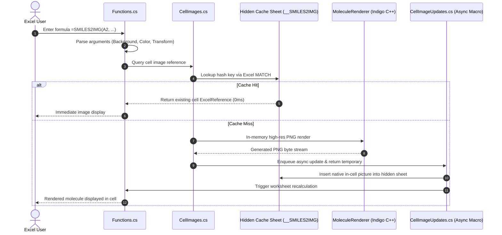

# func_SMILES2IMG — Free & Open-Source Office Chemical Add-in Suite (Excel · Word · PowerPoint)

[-blue.svg)](https://naramdash.github.io/func_SMILES2IMG/guide/getting-started)
[](LICENSE)
[](https://naramdash.github.io/func_SMILES2IMG/)
[](https://dotnet.microsoft.com/)
[](https://excel-dna.net/)
[](https://lifescience.opensource.epam.com/indigo/)
[](https://lifescience.opensource.epam.com/ketcher/)
[](https://molstar.org/)

> **A 100% free and open-source Microsoft Office add-in suite (Excel, Word, PowerPoint) to render publication-quality 2D chemical structures directly from SMILES/KET strings, explore 3D biological macromolecules via embedded Mol*, calculate chemical properties via native formulas, and sketch molecules interactively via embedded EPAM Ketcher.**  
> 100% local and offline execution without external web requests, cloud subscriptions, or administrative privileges.

---

## 📖 User Documentation

Complete user manuals, visual walkthroughs, parameter recipes, and guides for Excel, Word, and PowerPoint are hosted on our documentation site:

👉 **[Online Documentation Site (English & 한국어)](https://naramdash.github.io/func_SMILES2IMG/)**

* 📗 [**Microsoft Excel Guide**](https://naramdash.github.io/func_SMILES2IMG/guide/excel) — In-cell formulas (`=SMILES2IMG`, `=KET2IMG`), property calculation (`=SMILES2MW`, `=SMILES2NAME`, etc.), chemical styling, double-click editing.
* 📘 [**Microsoft Word Guide**](https://naramdash.github.io/func_SMILES2IMG/guide/word) — Inline figures, ribbon `[SMILES]` tab, 0.1s Quick Insert, Mol* 3D models, table layout preservation.
* 📙 [**Microsoft PowerPoint Guide**](https://naramdash.github.io/func_SMILES2IMG/guide/powerpoint) — One-click slide placement, dark theme transparent backgrounds, Mol* interactive 3D GLB models.
* ✏️ [**Ketcher 2D Editor Guide**](https://naramdash.github.io/func_SMILES2IMG/guide/ketcher) — Offline structure sketcher, multi-step reaction schemes, molecular weight calculation.
* 🧬 [**Mol* 3D Viewer Guide**](https://naramdash.github.io/func_SMILES2IMG/guide/molstar) — Macromolecular 3D viewer (PDB/mmCIF), direct PDB download, rotatable GLB 3D models & 2D pictures.
* 📐 [**Excel Formula Reference**](https://naramdash.github.io/func_SMILES2IMG/reference/formula) — Full parameter specifications for rendering and property calculation formulas.
* ❓ [**Troubleshooting & FAQ**](https://naramdash.github.io/func_SMILES2IMG/guide/faq) — Smart App Control, `#VALUE!` resolution, and version compatibility.

---

## ⚡ Quick Install

Open **PowerShell** and run this single command to automatically install, configure security, and register the add-in across the entire Microsoft Office suite (Excel, Word, PowerPoint):

```powershell
# Stable release (v1.5.0)
irm https://raw.githubusercontent.com/naramdash/func_SMILES2IMG/main/install.ps1 | iex
```

::: tip 💡 Preview Release (Mol* 3D & Molecular Property Functions)
To test the latest preview release featuring the Mol* 3D Viewer and Molecular Property functions:
```powershell
$v='v1.6.0-preview.1'; irm https://raw.githubusercontent.com/naramdash/func_SMILES2IMG/main/install.ps1 | iex
```
:::

> **What the installer automates:**  
> 1. Detects your Office bitness (32-bit vs. 64-bit) and installed Office applications (Excel, Word, PowerPoint)  
> 2. Downloads and places the unified suite (Excel XLL, Word COM DLL, PowerPoint COM DLL) in `%APPDATA%\Microsoft\AddIns\Smiles2Img`  
> 3. Unblocks files (`Unblock-File`) to remove Windows security flags automatically  
> 4. Registers Excel, Word, and PowerPoint add-ins in HKCU registry (no admin rights required, loads automatically on start)  
> 💡 **Future Updates:** Running this exact command again in the future automatically upgrades to the latest release!  
> 🗑️ **Uninstallation:** Run `irm https://raw.githubusercontent.com/naramdash/func_SMILES2IMG/main/uninstall.ps1 | iex` anytime to cleanly remove all files and registry entries.

---

## ✨ Key Features

* ⚡ **Real-Time In-Cell Chemical Rendering:** `=SMILES2IMG(A2)` and `=KET2IMG(A2)` render native cell pictures in Microsoft Excel that scale with row/column sizing and recalculate dynamically.
* 🔬 **Molecular Property Calculation Formulas:** Direct cell formulas `=SMILES2NAME`, `=SMILES2MW`, `=SMILES2FORMULA`, `=SMILES2INCHI`, and `=SMILES2INCHIKEY` (as well as `=KET2*` variants) for high-throughput cheminformatics.
* 📋 **One-Click Molecule Info & Direct Copy:** Right-click context submenu across Excel, Word, and PowerPoint to instantly copy Substance Name, Formula, MW, SMILES, InChI, or InChIKey with smooth floating badge feedback near the cursor (zero focus-stealing modal dialogs).
* ✏️ **Embedded Ketcher 2D Visual Sketcher:** 100% offline molecular editor supporting atoms, bonds, rings, charges, and multi-step reaction schemes with arrows and plus signs.
* 🧬 **Embedded Mol\* 3D Macromolecular Viewer:** Visualize proteins, nucleic acids, and complexes directly across Excel, PowerPoint, and Word. Download PDB structures by ID, insert rotatable 3D GLB models or 2D publication images, and re-edit anytime with double-click.
* 🔄 **Lossless Document Persistence:** KET coordinates, chemical annotations, and Mol* 3D session recipes (`.molj`) are stored losslessly inside document XML metadata (`CustomXMLParts`), allowing seamless re-editing when sharing files with collaborators.
* 🛡️ **100% Local & Privacy-Preserving:** Powered by embedded EPAM Indigo, EPAM Ketcher, and Mol* runtimes. Zero cloud calls, zero data leakage, works completely offline.

---

## 🏗️ Architecture & Internal Lifecycle



* **100% In-Memory Offline Execution:** Eliminates external network calls, Node.js processes, or cloud API frameworks.
* **Cache Persistence & Workbook Portability:** Images are cached in an internal hidden sheet (`__SMILES2IMG`), ensuring instant restoration when workbooks are saved and reopened.
* **Aspect-Ratio Preserving Shape Updates:** Word and PowerPoint add-ins replace structure images in-place without altering coordinates, table cell widths, or margins.

---

## 📂 Project Directory Structure

```text
func_SMILES2IMG/
├── Smiles2Img.sln                      # Visual Studio / .NET unified solution file
├── Directory.Build.props               # Shared version, TFM (net48), and compiler configuration
├── package.json                        # VitePress documentation dependencies and scripts
├── .github/
│   └── workflows/
│       └── deploy-docs.yml             # GitHub Actions workflow for building & deploying docs to GitHub Pages
├── docs/                               # VitePress documentation source
│   ├── .vitepress/
│   │   └── config.mts                  # VitePress site configuration & i18n routing
│   ├── public/                         # Static assets (images, icons)
│   ├── guide/                          # English guides (getting started, excel, word, powerpoint, ketcher, molstar, faq)
│   ├── reference/                      # English reference (formulas & parameter specs)
│   └── ko/                             # Korean guides & reference (ko/guide/*, ko/reference/*)
├── src/
│   ├── Smiles2Img.Core/                # Shared rendering, Ketcher 2D, Mol* 3D & notification core (net48)
│   │   ├── Rendering/                  # EPAM Indigo 1.49.0 wrapper, ACS standards, color/option parsers, PubChem resolver
│   │   ├── Editor/                     # Ketcher v3.18.0 & Mol* v5.13.1 forms, session managers, StructureMetadata, CopiedToast
│   │   ├── Notifications/              # Non-intrusive floating badges and notification service
│   │   └── COM/                        # Shared Office COM interfaces (IDTExtensibility2, IRibbonExtensibility)
│   ├── Smiles2Img.Excel/               # Excel-DNA standalone XLL add-in (net48)
│   │   ├── Functions.cs                # =SMILES2IMG, =KET2IMG, and property calculation UDFs (=SMILES2NAME, =SMILES2MW, etc.)
│   │   ├── FloatFunctions.cs           # =SMILES2IMG.FLOAT & =KET2IMG.FLOAT floating UDFs (Excel 2016-2021)
│   │   ├── CellImages.cs               # In-cell image cache manager
│   │   ├── FloatingPictures.cs         # Cell-anchored floating shape manager
│   │   ├── SmilesRibbon.cs             # [SMILES] ribbon tab & right-click context menu handlers (Copy Molecule Info submenu)
│   │   ├── KetcherEditor.cs            # Ketcher commands, quick paste, molecule info & double-click hooks
│   │   ├── KetcherEditor.ShapesAndCells.cs # KET canvas shape & formula cell extraction/insertion helpers
│   │   └── ExcelMolstarManager.cs      # Mol* 3D viewer integration, floating GLB/PNG insertion & session re-editing
│   ├── Smiles2Img.Word/                # Word COM add-in DLL (net48)
│   │   ├── WordAddIn.cs                # IDTExtensibility2 + IRibbonExtensibility + context menu handlers
│   │   └── WordStructureManager.cs     # Inline structure images, Mol* 3D models, replacement, quick paste & double-click
│   └── Smiles2Img.PowerPoint/          # PowerPoint COM add-in DLL (net48)
│       ├── PowerPointAddIn.cs          # IDTExtensibility2 + IRibbonExtensibility + context menu + double-click hook
│       └── PowerPointStructureManager.cs # Slide structure shape insertion, Mol* 3D models, replacement, quick paste & metadata
├── dist/                               # Distribution output directory
│   ├── x64/
│   │   ├── Smiles2Img-AddIn64-packed.xll # 64-bit standalone Excel XLL
│   │   ├── Word/                       # 64-bit Word COM add-in binaries
│   │   ├── PowerPoint/                 # 64-bit PowerPoint COM add-in binaries
│   │   └── Smiles2Img-Office-x64.zip   # 64-bit unified Office Suite package
│   └── x86/
│       ├── Smiles2Img-AddIn-packed.xll   # 32-bit standalone Excel XLL
│       ├── Word/                       # 32-bit Word COM add-in binaries
│       ├── PowerPoint/                 # 32-bit PowerPoint COM add-in binaries
│       └── Smiles2Img-Office-x86.zip   # 32-bit unified Office Suite package
├── assets/                             # Visual showcase assets & documentation screenshots
├── tests/                              # Automated test suites
│   ├── Excel-Smoke.ps1                 # Full COM automation E2E smoke tests
│   ├── Excel-365-FeatureTests.ps1      # Live Excel 365 new styles & full-option tests
│   ├── Excel-DeepStressTests.ps1       # Bulk rendering & edge-case stress test
│   ├── Program.cs                      # Unit tests + live WebView2/Ketcher v3.18.0 E2E round-trip runner
│   └── Smiles2Img.Tests.csproj
├── scripts/
│   ├── Test-OfficeE2E.ps1              # Unified Word, PowerPoint, and Excel COM Add-in E2E test suite
│   ├── Package-Release.ps1             # Release archive packaging script
│   └── Generate-Showcase-Workbook.ps1  # Showcase workbook generator
├── install.ps1                         # Unified Office Suite one-click installer
├── uninstall.ps1                       # Unified Office Suite uninstaller
├── THIRD_PARTY_NOTICES.md              # Open-source license acknowledgments
└── README.md                           # Main developer documentation (this file)
```

---

## 🛠️ Building & Distribution (For Developers)

### Prerequisites
* Windows 10 / 11
* [.NET SDK 8.0 or newer](https://dotnet.microsoft.com/) (targeting .NET Framework 4.8)
* [Node.js 18+ & npm](https://nodejs.org/) (for building the VitePress documentation)

### Full Solution Build Command
Run from the repository root:

```powershell
# Restore dependencies & build entire solution (packs Excel XLL and compiles Word/PowerPoint add-ins)
dotnet build Smiles2Img.sln -c Release

# Generate release ZIP archives
powershell -ExecutionPolicy Bypass -File scripts\Package-Release.ps1
```

The resulting packed XLLs in `dist/x64/` and `dist/x86/` contain all dependencies (ExcelDna, IntelliSense, Indigo C++ runtimes) within a single self-extracting archive.

### Documentation Build Command
To develop or build the VitePress documentation locally:

```powershell
# Start local development server with hot reload
npm run docs:dev

# Build static documentation for production
npm run docs:build

# Preview production build locally
npm run docs:preview
```

---

## 🧪 Automated Testing & Verification

### 1. Core Unit Tests + Live WebView2 Ketcher E2E Tests (Office not required)
Verifies molecule rendering, chiral hydrogen retention, transforms, alpha transparency, molecule properties (`Formula`, `MW`, `Exact Mass`), Office Ribbon XML reflection, and live WebView2 + EPAM Ketcher v3.18.0 round-trip (`SMILES` $\leftrightarrow$ `KET` + Transparent/White PNG export):

```powershell
dotnet build tests/Smiles2Img.Tests.csproj -c Release --no-restore --tl:off
& tests/bin/Release/net48/Smiles2Img.Tests.exe
```

### 2. Unified Office Suite COM E2E Tests (Word + PowerPoint + Excel)
Launches live instances of **Microsoft Word, PowerPoint, and Excel** to verify COM add-in registration, `KET` + `SMILES` metadata round-tripping (`AlternativeText`, `Title`, `Tags`), aspect-ratio preserving in-place updates, and formula evaluation:

```powershell
powershell -NoProfile -STA -ExecutionPolicy Bypass -File scripts/Test-OfficeE2E.ps1
```

### 3. Excel COM E2E Automation Smoke Tests (Runs live Excel)
Automates an actual background Excel instance to test full lifecycle reliability:

```powershell
powershell -NoProfile -STA -ExecutionPolicy Bypass -File tests/Excel-Smoke.ps1
```
* XLL registration and formula discovery
* In-cell picture embedding and formula persistence
* Real-time image replacement upon SMILES modification (zero floating shapes)
* Cache hit instantaneous reuse across multiple cells
* Workbook saving, reopening, and cache restoration
* Automatic orphaned cache cleanup when formulas are deleted

### 4. Excel 365 Real-World Feature & Bulk Stress Tests
Validates modern delimiters, ultimate full-option formulas, and 20+ concurrent complex molecules:

```powershell
# Live Excel 365 feature & full-option suite
powershell -NoProfile -STA -ExecutionPolicy Bypass -File tests/Excel-365-FeatureTests.ps1

# 20-molecule bulk rendering & stress suite
powershell -NoProfile -STA -ExecutionPolicy Bypass -File tests/Excel-DeepStressTests.ps1
```

---

## 📄 License & Third-Party Notices

* Licensed under the [MIT License](LICENSE).
* See [THIRD_PARTY_NOTICES.md](THIRD_PARTY_NOTICES.md) for licenses and copyright notices of embedded third-party components (EPAM Indigo, EPAM Ketcher, Excel-DNA, Microsoft Edge WebView2).
