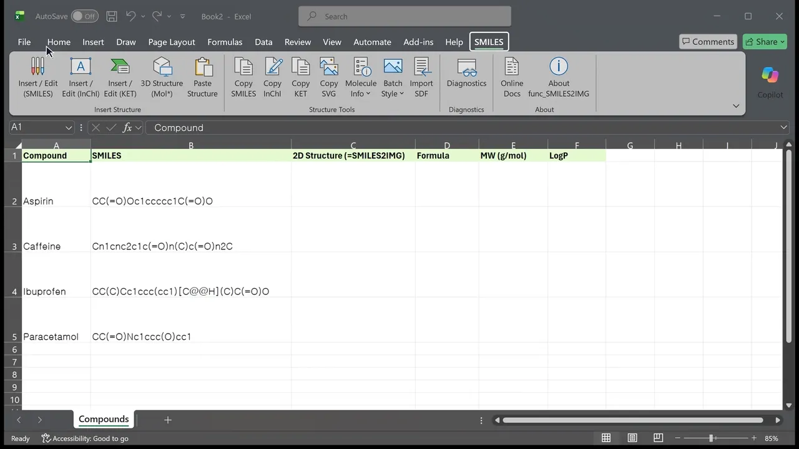
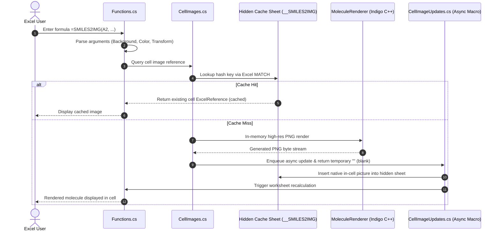

# func_SMILES2IMG — Chemical Structures & 3D Proteins inside Excel, Word & PowerPoint

[-blue.svg)](https://naramdash.github.io/func_SMILES2IMG/guide/)
[](LICENSE)
[](https://naramdash.github.io/func_SMILES2IMG/)
[](https://naramdash.github.io/func_SMILES2IMG/ko/)
[](https://dotnet.microsoft.com/)
[](https://excel-dna.net/)
[](https://lifescience.opensource.epam.com/indigo/)
[](https://lifescience.opensource.epam.com/ketcher/)
[](https://molstar.org/)

> Type a compound name or SMILES to render 2D chemical structures, molecular weights, LogP/TPSA, and 3D complexity metrics across Excel rows. Double-click any cell or picture to sketch in 2D with embedded EPAM Ketcher, or rotate 3D proteins with Mol\* — **free, open-source, and local-first (no admin rights required).**

<p align="center">
  
</p>

---

## 📖 User Documentation

* 🇰🇷 **[한국어 공식 가이드 및 빠른 시작](https://naramdash.github.io/func_SMILES2IMG/ko/)**
* 🇺🇸 **[English Documentation & Quickstart](https://naramdash.github.io/func_SMILES2IMG/)**
* 📊 **[📥 Download Self-Contained Excel Playbook (.xlsx)](https://raw.githubusercontent.com/naramdash/func_SMILES2IMG/main/examples/func_SMILES2IMG_Excel_Playbook.xlsx)** — 10-tab interactive workbook with live formulas, physicochemical & 3D complexity KPIs, SMARTS dictionary, stoichiometry & hit-to-lead workflows, KET reactions, `.FLOAT`, and all 49 functions.
* 📝 **[📥 Download Self-Contained Word Playbook (.docx)](https://raw.githubusercontent.com/naramdash/func_SMILES2IMG/main/examples/func_SMILES2IMG_Word_Playbook.docx)** — 6-page hands-on manuscript with double-click-editable structures, journal SAR table, KET synthesis schemes, Mol\* 3D `1CRN` figure, and ACS B&W exercise.
* 🎨 **[📥 Download Self-Contained PowerPoint Playbook (.pptx)](https://raw.githubusercontent.com/naramdash/func_SMILES2IMG/main/examples/func_SMILES2IMG_PowerPoint_Playbook.pptx)** — 8-slide dark-mode interactive deck with TextBox conversion lab, 4-card screening grid, KET mechanism slide, Mol\* 3D target, Q&A `Molecule Info`, and speaker notes.

---

## ⚡ Quick Install (Excel · Word · PowerPoint)

Open **PowerShell** and run this single command to automatically install, configure security, and register the add-in across Microsoft Office (Excel, Word, PowerPoint):

```powershell
# Latest stable release (v1.9.1)
irm https://raw.githubusercontent.com/naramdash/func_SMILES2IMG/main/install.ps1 | iex
```

> **What the installer automates:**  
> 1. Detects your Office bitness (32-bit vs. 64-bit) and installed Office applications (Excel, Word, PowerPoint)  
> 2. Downloads and places `func_SMILES2IMG` (Excel XLL, Word COM DLL, PowerPoint COM DLL) in `%APPDATA%\Microsoft\AddIns\Smiles2Img`  
> 3. Unblocks files (`Unblock-File`) to remove Windows security flags automatically  
> 4. Registers Excel, Word, and PowerPoint add-ins in HKCU registry (no admin rights required, loads automatically on start)  
> 💡 **Future Updates:** Running this exact command again in the future automatically upgrades to the latest release!  
> 🗑️ **Uninstallation:** Run `irm https://raw.githubusercontent.com/naramdash/func_SMILES2IMG/main/uninstall.ps1 | iex` anytime to cleanly remove all files and registry entries.

---

## ✨ Key Features

* ⚡ **Real-Time In-Cell Chemical Rendering:** `=SMILES2IMG(A2)`, `=KET2IMG(A2)`, `=INCHI2IMG(A2)`, and `=NAME2IMG(A2)` render native cell pictures in Microsoft Excel that scale with row/column sizing and recalculate dynamically, with substructure highlighting (`"hl:c1ccccc1"`).
* 🔬 **Comprehensive Offline Cheminformatics (SMILES · InChI · KET Parity):** Direct cell formulas `=SMILES2NAME`, `=NAME2SMILES`, `=KET2SMILES`, `*2MW`, `*2EXACTMASS`, `*2FORMULA`, `*2INCHI`, `*2INCHIKEY`, `*2LOGP`, `*2TPSA`, `*2HEAVY`, `*2RINGS`, `*2AROMATIC`, `*2FSP3`, `=SMILES.MATCH`, `=INCHI.MATCH`, and `=KET.MATCH`.
* 📋 **Molecule Info, Vector SVG Copy & Lossless Batch Style:** Right-click context submenu and Ribbon tools across Excel, Word, and PowerPoint to copy Substance Name, Formula, MW, SMILES, InChI, InChIKey, or **Vector SVG (`Copy SVG`)**, normalize structure styles losslessly while keeping highlights and rotations (**`Batch Style`**), and import 11-column `.sdf` chemical database tables in Excel (**`Import SDF`**).
* ✏️ **Embedded Ketcher 2D Visual Sketcher:** Offline molecular editor with warm WebView2 instance reuse supporting atoms, bonds, rings, charges, and multi-step reaction schemes.
* 🧬 **Embedded Mol\* 3D Macromolecular Viewer:** Visualize proteins, nucleic acids, and complexes directly across Excel, PowerPoint, and Word. Download PDB structures by ID, insert rotatable 3D GLB models or 2D publication images, and re-edit anytime with double-click.
* 🔄 **Lossless Document Persistence:** KET coordinates, chemical annotations, and Mol* 3D session recipes (`.molj`) are stored losslessly inside document XML metadata (`CustomXMLParts`), allowing seamless re-editing when sharing files with collaborators.
* 🛡️ **Local-First & Privacy-Preserving:** Core 2D rendering (EPAM Indigo), 2D sketching (EPAM Ketcher), and all physicochemical/SAR calculations run locally on your PC. Internet access is only used optionally for uncached PubChem name/CAS lookups, RCSB PDB ID fetches in Mol\*, and manual update checks.

---

## 🏗️ Architecture & Internal Lifecycle



* **Local In-Memory Rendering:** Core structure rendering and property calculations execute locally in-process without external rendering servers or Node.js runtimes.
* **Cache Persistence & Workbook Portability:** Images are cached in an internal hidden sheet (`__SMILES2IMG`), allowing direct restoration when workbooks are saved and reopened.
* **Aspect-Ratio Preserving Shape Updates:** Word and PowerPoint add-ins replace structure images in-place without altering coordinates, table cell widths, or margins.

---

## 📂 Project Directory Structure

```text
func_SMILES2IMG/
├── Smiles2Img.sln                      # Visual Studio / .NET unified solution file
├── Directory.Build.props               # Shared version, TFM (net48), and compiler configuration
├── package.json                        # VitePress documentation dependencies and scripts
├── .editorconfig & .vscode/            # Enforces UTF-8 (no BOM) & CRLF across editors
├── .github/workflows/                  # GitHub Actions workflows
│   ├── ci.yml                          # Release build + 31 Unit/WebView2 E2E test suites
│   ├── release.yml                     # Release packaging, installer encoding check & GitHub Release
│   └── deploy-docs.yml                 # Docs link & live-media audits + GitHub Pages deployment
├── docs/                               # VitePress documentation source
│   ├── .vitepress/                     # VitePress config, i18n routing & minimal Vue components (FeatureMedia, FormulaTable, QuickInstallBox, PlaybookPreview, ImageLightbox, SidebarToggle)
│   ├── public/                         # Live Office media (/media/<id>/* PNG/WebM/MP4/VTT), showcase XLSX & sample SDF
│   ├── guide/                          # English Guide (/guide/, /guide/faq)
│   ├── excel/                          # English Excel (/excel/, structures, properties, sar, formulas)
│   ├── word/ & powerpoint/ & editor/   # English Word, PowerPoint, and shared Editor (Ketcher, Mol*, publishing)
│   └── ko/                             # Korean mirror (ko/guide, ko/excel, ko/word, ko/powerpoint, ko/editor)
├── src/
│   ├── Smiles2Img.Core/                # Shared rendering, Ketcher 2D, Mol* 3D, UI & COM core (net48)
│   │   ├── Rendering/                  # EPAM Indigo 1.49.0 wrapper (MoleculeRenderer, MoleculeInfo, SdfManager, PubChemResolver)
│   │   ├── Editor/                     # Ketcher v3.18.0 & Mol* v5.13.1 (WebView2 1.0.4314.35), RibbonXmlBuilder, WebView2HostHelper, MoleculeActionHelper
│   │   ├── Notifications/              # Non-intrusive floating badges and notification service
│   │   └── COM/                        # Shared Office COM interfaces (IDTExtensibility2, IRibbonExtensibility)
│   ├── Smiles2Img.Excel/               # Excel-DNA standalone XLL add-in (net48)
│   │   ├── Functions.cs                # 45 in-cell & scalar UDFs (=SMILES2IMG, =INCHI2*, =KET2*, =SMILES.MATCH, etc.)
│   │   ├── FloatFunctions.cs           # 4 floating shape UDFs (.FLOAT for Excel 2016-2021)
│   │   ├── CellImages.cs               # In-cell image cache manager
│   │   ├── FloatingPictures.cs         # Cell-anchored floating shape manager
│   │   ├── SmilesRibbon.cs             # [SMILES] ribbon tab & right-click context menu callbacks
│   │   ├── KetcherEditor.cs            # Ketcher commands, quick paste, SDF import, molecule info & double-click hooks
│   │   ├── KetcherEditor.ShapesAndCells.cs # KET canvas shape & formula cell extraction/insertion helpers
│   │   └── ExcelMolstarManager.cs      # Mol* 3D viewer integration, floating GLB/PNG insertion & session re-editing
│   ├── Smiles2Img.Word/                # Word COM add-in DLL (net48)
│   │   ├── WordAddIn.cs                # IDTExtensibility2 + IRibbonExtensibility + context menu callbacks
│   │   ├── WordStructureManager.cs     # 2D inline/floating structure images, Batch Style, quick paste & double-click
│   │   └── WordStructureManager.Molstar.cs # Partial class handling Word Mol* 3D models & CustomXMLParts persistence
│   └── Smiles2Img.PowerPoint/          # PowerPoint COM add-in DLL (net48)
│       ├── PowerPointAddIn.cs          # IDTExtensibility2 + IRibbonExtensibility + context menu + double-click hook
│       ├── PowerPointStructureManager.cs # 2D slide structure shape insertion, Batch Style, quick paste & metadata
│       └── PowerPointStructureManager.Molstar.cs # Partial class handling slide Mol* 3D models & persistence
├── dist/                               # Distribution output directory (generated by Release build / packaging)
│   ├── x64/                            # 64-bit standalone XLL, Word/PowerPoint DLLs & func_SMILES2IMG-x64.zip
│   └── x86/                            # 32-bit standalone XLL, Word/PowerPoint DLLs & func_SMILES2IMG-x86.zip
├── examples/                           # Self-contained interactive Playbooks (Excel .xlsx, Word .docx, PowerPoint .pptx) & sample SDF
├── assets/                             # Visual showcase assets & documentation screenshots
├── tests/                              # Categorized Unit & E2E test suites
│   ├── Unit/                           # RenderingUnitTests, CheminformaticsUnitTests, UiAndRibbonUnitTests
│   ├── E2E/                            # WebView2EditorE2ETests (Ketcher/Mol*/Dialogs) & OfficeLiveE2ERunner
│   ├── TestAssert.cs                   # Shared test assertions & suite logging
│   ├── Program.cs                      # Test runner CLI entry point (supports --full)
│   ├── Excel-Smoke.ps1                 # Standalone Excel COM automation smoke tests
│   ├── Excel-365-FeatureTests.ps1      # Live Excel 365 feature & full-option tests
│   ├── Excel-DeepStressTests.ps1       # Bulk rendering & edge-case stress test
│   ├── packages.lock.json              # Reproducible NuGet restore lock file
│   └── Smiles2Img.Tests.csproj
├── scripts/
│   ├── Test-OfficeE2E.ps1              # Unified Live Word, PowerPoint, and Excel COM/XLL + UI E2E suite
│   ├── Package-Release.ps1             # Builds Release, strips UTF-8 BOM from installers & creates ZIP archives
│   ├── Generate-All-Playbooks.ps1      # Regenerates & verifies Excel, Word & PowerPoint Playbooks and syncs docs/public/examples/
│   ├── Generate-Excel-Playbook.ps1     # 10-tab self-contained Excel Playbook generator + formula error audit
│   ├── Generate-Word-Playbook.ps1      # 6-page live Word COM Playbook generator with embedded SMILES/KET/Mol* metadata
│   ├── Generate-PowerPoint-Playbook.ps1 # 8-slide live PowerPoint COM Playbook generator with Shape.Tags & speaker notes
│   ├── Capture-LiveDocsMedia.ps1       # Records live Office screenshots (.png), videos (.webm/.mp4), and captions (.vtt)
│   ├── Capture-InteractiveMenus.ps1    # Captures 3-level native Office right-click context menus via UIA + PrintWindow
│   ├── Install-OfficeEnglishPack.ps1   # Configures Office UI to en-US (HKCU + optional admin ODT en-US pack installer)
│   ├── LiveCaptureEngine.cs            # Per-Monitor DPI-aware multi-HWND compositor & UIA helper for live captures
│   ├── audit-docs-links.js             # Audits internal Markdown/HTML links & base paths across docs/
│   └── audit-docs-media.js             # Verifies live PNG/WebM/MP4/VTT coverage & AGENTS.md naming compliance
├── install.ps1                         # Unified Office add-in installer (clean-install/upgrade summary)
├── uninstall.ps1                       # Unified Office add-in uninstaller (removal summary report)
├── THIRD_PARTY_NOTICES.md              # Open-source license acknowledgments
└── README.md                           # Main developer documentation (this file)
```

---

## 🛠️ Building & Distribution (For Developers)

### Prerequisites
* Windows 10 / 11
* [.NET SDK 8.0 or newer](https://dotnet.microsoft.com/) (targeting .NET Framework 4.8)
* [Node.js 18+ & npm](https://nodejs.org/) (for building the VitePress documentation)

### Full Solution Build Command
Run from the repository root:

```powershell
# Restore dependencies & build entire solution (packs Excel XLL and compiles Word/PowerPoint add-ins)
dotnet build Smiles2Img.sln -c Release

# Generate release ZIP archives
powershell -ExecutionPolicy Bypass -File scripts\Package-Release.ps1
```

The resulting packed XLLs in `dist/x64/` and `dist/x86/` contain all dependencies (ExcelDna, IntelliSense, Indigo C++ runtimes) within a single self-extracting archive.

### Documentation Build Command
To develop or build the VitePress documentation locally:

```powershell
# Start local development server with hot reload
npm run docs:dev

# Build static documentation for production
npm run docs:build

# Preview production build locally
npm run docs:preview
```

---

## 🧪 Automated Testing & Verification

### 1. Category 1 Unit Tests (25 Suites) + Category 2 WebView2 / WinForms UI E2E (6 Suites)
Runs **31 test suites** (no Microsoft Office installation required): verifies 2D PNG/SVG rendering, stereochemical rendering, transforms, molecule properties and complexity descriptors (`Formula`, `MW`, `Exact Mass`, `LogP`, `TPSA`, `Heavy Atoms`, `Rings`, `Aromatic Rings`, `Fsp3`), a 57-compound real-substance benchmark & SMILES↔InChI↔KET parity matrix (`RealSubstanceEdgeCaseTests`), Excel/Word/PowerPoint Ribbon & ContextMenu XML (`ValidateRibbonXml` + `VerifiedValidOfficeImageMsos`), `ExcelFormulaRewriter`, `ThreadMouseDoubleClickHook` filtering, WinForms dialogs (`MoleculeInfoDialog`, `AboutDialog`, `CopiedToast`), and live WebView2 Ketcher v3.18.0 + Mol\* v5.13.1 round-trip UI capture:

```powershell
dotnet run --project tests -c Release
```

### 2. Full End-to-End Test Suite Including Live Office COM/XLL Automation (32 Suites)
Executes all 31 Unit & WebView2 UI suites plus live Microsoft **Word (COM)**, **PowerPoint (COM)**, and **Excel (Live `.xll` UDFs, SDF Import, Batch Style & Modal UI popups)** automation:

```powershell
dotnet run --project tests -c Release -- --full

# Or run the live Office suite script directly after building:
powershell -NoProfile -STA -ExecutionPolicy Bypass -File scripts/Test-OfficeE2E.ps1
```

### 3. Additional Excel COM Automation Smoke & Stress Scripts
```powershell
# Standalone Excel lifecycle & cache restoration smoke tests
powershell -NoProfile -STA -ExecutionPolicy Bypass -File tests/Excel-Smoke.ps1

# Live Excel 365 feature & full-option suite
powershell -NoProfile -STA -ExecutionPolicy Bypass -File tests/Excel-365-FeatureTests.ps1

# 20-molecule bulk rendering & stress suite
powershell -NoProfile -STA -ExecutionPolicy Bypass -File tests/Excel-DeepStressTests.ps1
```

### 4. Documentation Audits & Static Site Build
```powershell
node scripts/audit-docs-links.js
node scripts/audit-docs-media.js
npm run docs:build
```

---

## 📄 License & Third-Party Notices

* Licensed under the [MIT License](LICENSE).
* See [THIRD_PARTY_NOTICES.md](THIRD_PARTY_NOTICES.md) for licenses and copyright notices of embedded third-party components (EPAM Indigo `1.49.0`, EPAM Ketcher `v3.18.0`, Mol\* `v5.13.1`, IUPAC InChI Toolkit `1.07.1`, Excel-DNA `1.9.0`, Microsoft Edge WebView2 `1.0.4314.35`).
