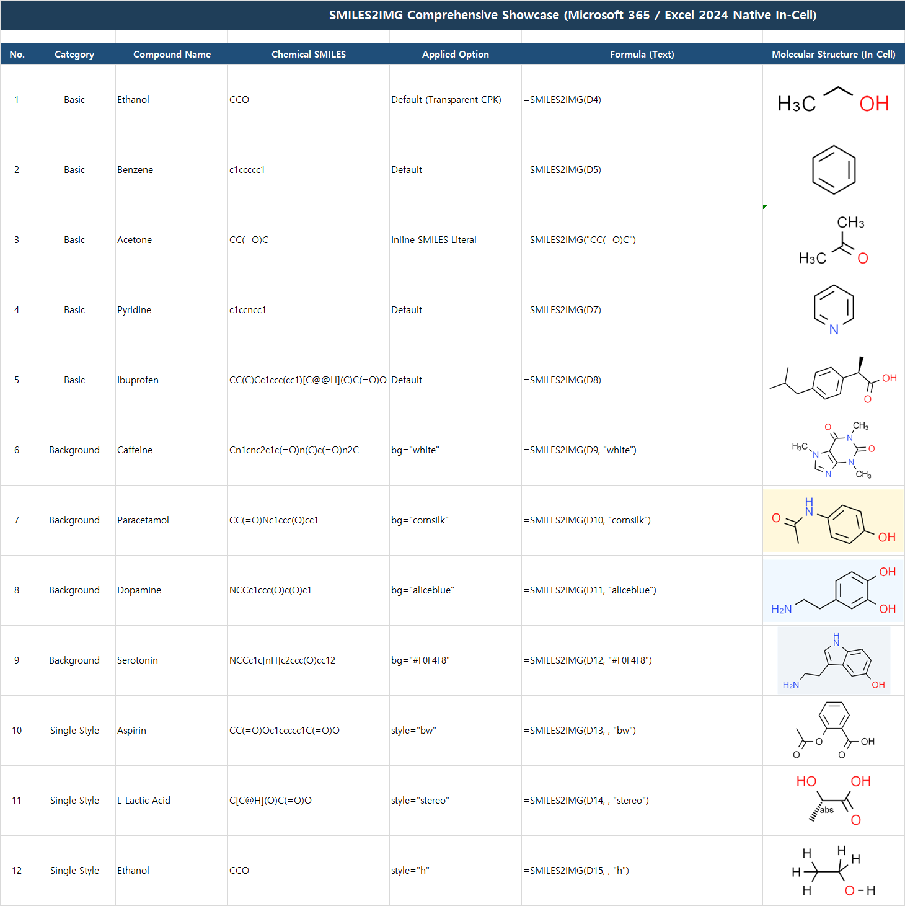
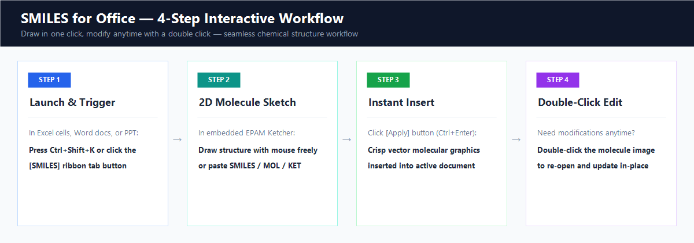
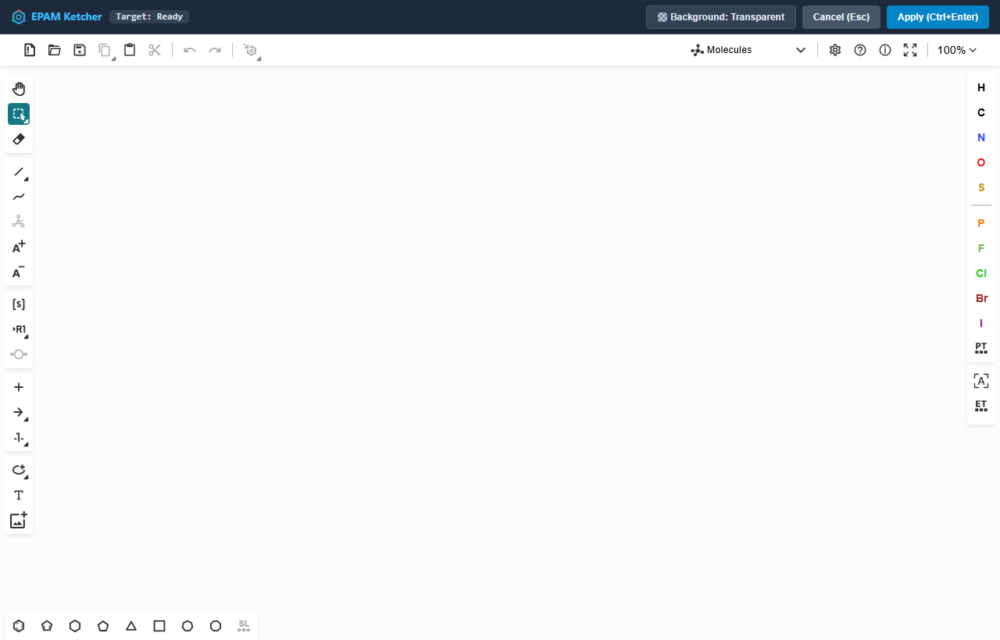
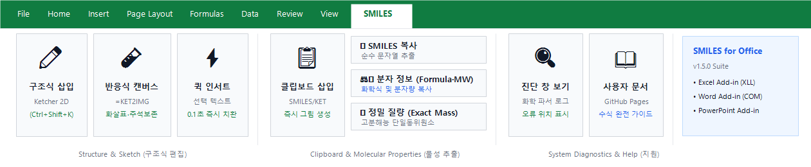
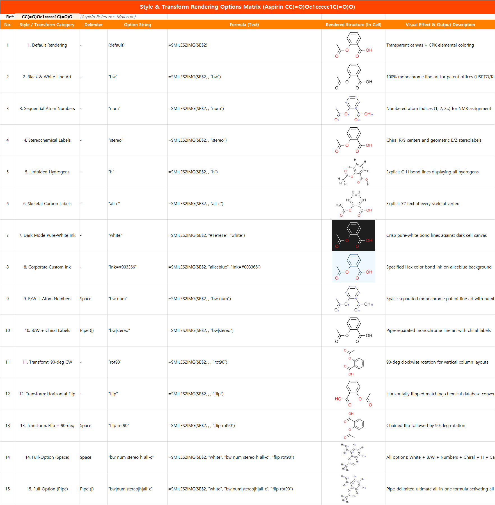

# 📗 SMILES for Excel — 초간편 사용법 완벽 가이드

[🏠 메인 홈으로](../README.KR.md) · [📘 Word 가이드](WORD_GUIDE.md) · [📙 PowerPoint 가이드](POWERPOINT_GUIDE.md)

---

## 🌟 1. 한눈에 보는 핵심 기능

엑셀 셀 안에 고해상도 2D 화학 구조식을 즉시 삽입하고, 마우스 더블 클릭으로 언제든 수정할 수 있는 화학 연구용 추가 기능입니다.

<p align="center">
  
</p>

```
┌────────────────────────────────────────────────────────────────────────────────────────┐
│  ✨ 4줄 요약: 이것만 알면 끝!                                                          │
│                                                                                        │
│  1. 빈 셀에 바로 그리기  ➔  [Ctrl + Shift + K] 누르고 그려서 [셀에 적용 (Ctrl+Enter)]  │
│  2. 수식으로 대량 삽입   ➔  =SMILES2IMG(A2) 입력 후 아래로 드래그 (Excel 2024 / M365)  │
│  3. 클립보드 즉시 삽입   ➔  SMILES 복사 후 [클립보드 즉시 삽입] 클릭                   │
│  4. 언제든 수정/정보확인 ➔  셀·캔버스 더블 클릭 수정 / 우클릭 [분자 정보 복사]         │
└────────────────────────────────────────────────────────────────────────────────────────┘
```

---

## 🔄 2. 원클릭 작업 흐름 & 듀얼 모드 (수식 + KET 캔버스)

<p align="center">
  
</p>

| 단계 | 수행 작업 | 상세 설명 |
| :---: | :--- | :--- |
| **STEP 1** | **에디터 호출** | • 셀 선택 후 단축키 <kbd>Ctrl</kbd> + <kbd>Shift</kbd> + <kbd>K</kbd><br>• 또는 마우스 우클릭 ➔ **`[분자 구조식 삽입 (셀 수식)...]`** / **`[캔버스 구조식 삽입 (KET)...]`**<br>• 또는 상단 리본 메뉴 **`[SMILES]`** ➔ **`[분자 구조식 삽입]`** / **`[캔버스 구조식 삽입]`** 클릭 |
| **STEP 2** | **2D 스케치** | • 팝업된 Ketcher v3.18.0 에디터에서 분자, 반응 화살표, 텍스트를 자유롭게 그립니다.<br>• 우측 상단 **`[배경: 투명 / 흰색]`** 버튼으로 배경을 전환할 수 있습니다. |
| **STEP 3** | **수식 vs 캔버스 적용** | • **셀 수식 모드**: 활성 셀에 `=SMILES2IMG("...")` 수식이 입력되며(반응식이나 텍스트가 포함된 경우에는 자동으로 KET 캔버스 도형으로 전환), **캔버스 모드**: 시트 위에 KET 메타데이터가 내장된 고해상도 캔버스 그림으로 배치됩니다 (`Ctrl+Enter`). |
| **STEP 4** | **언제든 더블 클릭 / 우클릭 수정** | • `=SMILES2IMG` 수식 셀을 더블 클릭하거나, KET 캔버스 도형을 더블 클릭/우클릭하여 언제든 원본 구조를 이어서 편집할 수 있습니다. |

---

## 🎨 3. 내장 Ketcher 에디터 화면 가이드

<p align="center">
  
</p>

### 주요 도구 조작 팁
* **단축키 및 빠른 적용**: 스케치 완료 후 <kbd>Ctrl</kbd> + <kbd>Enter</kbd>를 누르면 즉시 엑셀에 반영됩니다.
* **원소 바꾸기**: 좌측 팔레트에서 원소(C, N, O, S, P 등)를 클릭한 후 캔버스의 원자를 클릭하거나, 원자 위에 마우스를 올리고 키보드로 직접 타이핑(예: `O`, `N`, `Cl`)해도 즉시 변경됩니다.
* **입체 화학(Stereochemistry)**: 상단 툴바에서 쐐기 결합(Wedge Bond `◢`) 또는 점선 결합(Hash Bond `▰`)을 선택하여 R/S 입체 이성질체를 정밀하게 표현할 수 있습니다.
* **100% 로컬 보안**: 외부 인터넷 서버나 웹 통신 없이, 여러분의 PC 내부 가상 호스트(`ketcher.local`)에서 100% 오프라인 구동되므로 **기업 기밀 화합물도 완벽하게 안전**합니다.

---

## 🛠️ 4. 엑셀 상단 리본 메뉴 및 우클릭 컨텍스트 메뉴

<p align="center">
  
</p>

### 상단 `[SMILES]` 리본 탭
| 버튼 아이콘 | 기능 이름 | 용도 및 설명 |
| :---: | :--- | :--- |
| 🧬 | **분자 구조식 삽입** | Ketcher 에디터를 열어 화학 구조식을 그리고 현재 활성 셀에 수식(`=SMILES2IMG`)으로 삽입합니다 (`Ctrl+Shift+K`). |
| 🖼️ | **캔버스 구조식 삽입** | Ketcher 에디터를 열어 반응식, 화살표, 텍스트가 포함된 분자 구조식을 시트 위에 캔버스 이미지(`KET`)로 삽입합니다. |
| ⚡ | **클립보드 즉시 삽입** | 에디터를 열지 않고 클립보드에 복사된 SMILES 또는 KET 구조식을 현재 셀 또는 시트에 즉시 삽입합니다. |
| ✏️ | **구조식 편집** | 선택된 수식 셀(`=SMILES2IMG`) 또는 시트 위의 분자 캔버스 이미지를 Ketcher 에디터로 다시 불러와 수정합니다. |
| 📋 | **SMILES 복사** | 선택된 수식 셀 또는 분자 이미지에서 표준 SMILES 문자열을 추출하여 클립보드에 복사합니다. |
| 🧪 | **분자 정보 복사** | 선택된 셀 또는 분자 구조식의 **화학식(Formula)**, **분자량(MW)**, **정밀 질량(Exact Mass)**, **SMILES**를 즉시 계산하여 팝업으로 표시하고 클립보드에 복사합니다. |
| 🔍 | **진단 (Diagnostics)** | 화학 수식이 `#VALUE!`로 나올 때, 화학 파서(Indigo)가 감지한 정확한 오류 원인(닫히지 않은 고리, 잘못된 원자가 등)을 실시간 로그로 보여줍니다. |

### 마우스 오른쪽 클릭 (Context Menu)
* **셀 / 표 범위 우클릭**:
  * `분자 구조식 편집 (Ketcher)...`
  * `SMILES 복사 (추출)`
  * `분자 정보 (화학식·분자량) 복사`
  * `분자 구조식 삽입 (셀 수식)...`
  * `캔버스 구조식 삽입 (KET)...`
* **분자 그림 / 캔버스 도형 우클릭**:
  * `분자 구조식 편집 (Ketcher)...`
  * `SMILES 복사 (추출)`
  * `분자 정보 (화학식·분자량) 복사`
  * `캔버스 데이터(KET) 복사`

---

## 📖 5. 수식 규격 및 옵션 치트시트

```excel
=SMILES2IMG(smiles, [background], [style], [transform])
=SMILES2IMG.FLOAT(smiles, [background], [style], [transform])
```

### 1) 내 엑셀 버전에 맞는 함수 선택

| 엑셀 버전 | 추천 수식 | 동작 방식 및 특징 |
| :--- | :--- | :--- |
| **Excel 2024 / Microsoft 365** | `=SMILES2IMG(A2)` | **네이티브 인셀 이미지 (강력 추천)**<br>셀 안에 이미지가 완전히 포함되어 복사, 이동, 필터링, 정렬 시 셀과 함께 완벽하게 동작합니다. |
| **Excel 2016 / 2019 / 2021** | `=SMILES2IMG.FLOAT(A2)` | **셀 연동 플로팅 이미지**<br>인셀 이미지를 미지원하는 구버전 전용. 셀 위에 분자 그림이 배치되며 셀 크기 조절 시 자동으로 함께 움직입니다 (`xlMoveAndSize`). |

---

### 2) 인수별 옵션 정리표

| 인수 순서 | 이름 | 필수 | 기본값 | 사용 가능한 값 및 설명 |
| :---: | :--- | :---: | :---: | :--- |
| **1** | **`smiles`** | **필수** | - | 분자 SMILES 문자열 (예: `"CCO"`) 또는 참조 셀 (`A2`) |
| **2** | **`background`** | 선택 | `"trans"` | **캔버스 배경색:**<br>• `"trans"`: 투명 (기본값, 셀 채우기 색상과 자연스럽게 일치)<br>• `"white"`: 불투명 흰색 배경<br>• CSS 색상명: `"yellow"`, `"lightblue"`, `"lightgray"`, `"aliceblue"` 등 140+종<br>• Hex 코드: `"#FFFF00"`, `"1a1a1a"` |
| **3** | **`style`** | 선택 | `"color"` | **화학 렌더링 스타일 (공백 또는 `\|`로 자유롭게 조합 가능):**<br>• `"color"`: 기본 CPK 원소 색상 (산소=빨강, 질소=파랑, 황=황금색)<br>• `"bw"`: 100% 흑백 선화 (특허 출원 및 학술지 인쇄용)<br>• `"num"`: 원자 번호(1, 2, 3...) 표시 (NMR 피크 매핑 및 반응 추적용)<br>• `"stereo"`: 카이랄 입체 표시 (R/S, E/Z 라벨 명시)<br>• `"h"`: 생략된 수소 결합 펼치기 (입체 장애 및 반응성 확인)<br>• `"all-c"`: 골격 탄소 "C" 글자 모두 표기 (기초 유기화학 교육용)<br>• `"white"`: 어두운 배경용 순백색 분자선<br>• `"ink=#HEX"`: 기업 브랜드 전용 선 색상 지정 (예: `"ink=#003366"`) |
| **4** | **`transform`** | 선택 | `""` | **2D 회전 및 반전:**<br>• `"flip"`: 좌우 수평 반전 (교과서/논문 표준 방향 맞춤)<br>• `"flipy"`: 상하 수직 반전<br>• `"rot90"`, `"rot180"`, `"rot270"`: 90도 단위 시계방향 회전 |

---

## 🎯 6. "이럴 땐 이렇게!" 실전 수식 레시피

<p align="center">
  
</p>

| 내가 원하는 결과 | 복사해서 쓸 수식 | 실제 활용 상황 |
| :--- | :--- | :--- |
| **기본 고해상도 컬러 구조식** | `=SMILES2IMG(A2)` | 일상적인 화학 데이터 정리 |
| **특허 출원용 흑백 도면** | `=SMILES2IMG(A2, , "bw")` | 특허청(KIPO, USPTO) 명세서 첨부 도면 |
| **원자 번호가 매겨진 특허 도면** | `=SMILES2IMG(A2, , "bw num")` | 청구항 번호 및 반응 경로 설명 |
| **논문용 카이랄 라벨(R/S) 표기** | `=SMILES2IMG(A2, , "bw stereo")` | 저널 제출용 정밀 입체 구조 |
| **수소 결합이 모두 펼쳐진 구조** | `=SMILES2IMG(A2, , "h")` | 입체 장애(Steric Hindrance) 및 양성자 확인 |
| **모든 탄소 기호가 표기된 교재용** | `=SMILES2IMG(A2, , "all-c")` | 유기화학 강의 자료 및 학생 교육 |
| **다크 모드 슬라이드용 (화이트 선)** | `=SMILES2IMG(A2, "#1a1a1a", "white stereo")` | 어두운 배경의 연구 발표 자료 |
| **세로로 좁은 열에 맞추기 (90도 회전)** | `=SMILES2IMG(A2, , , "rot90")` | 길쭉한 선형 사슬 화합물 회전 배치 |
| **교과서 고리 방향으로 맞추기 (좌우 반전)**| `=SMILES2IMG(A2, , , "flip")` | 니코틴, 카페인 등 표준 고리 정렬 |
| **⭐ 모든 옵션 풀가동 종합 수식** | `=SMILES2IMG(A2, "white", "bw num stereo h all-c", "flip rot90")` | 흰색 배경 + 흑백 + 번호 + 카이랄 + 수소 + 탄소 + 반전 + 90도 회전 |

> [!TIP]
> **앞쪽 인수를 건너뛸 때는 쉼표만 입력하세요:**  
> 배경색은 기본 투명으로 두고 흑백 스타일만 적용하고 싶다면 `=SMILES2IMG(A2, , "bw")`와 같이 두 번째 인수를 비워두시면 됩니다.

---

## ❓ 7. 트러블슈팅 10초 해결 가이드

| 증상 | 원인 | 10초 해결 방법 |
| :--- | :--- | :--- |
| **`#VALUE!` 오류가 표시됨** | 유효하지 않은 SMILES 문자열이거나 병합된 셀을 참조함 | 1. 상단 리본의 **[SMILES] ➔ [Show Diagnostics]**를 열어 정확한 오류 메시지를 확인하세요.<br>2. 병합된 셀의 경우 좌상단 셀 번호를 직접 지정하세요. |
| **`#NAME?` 오류 또는 파일 확장명 경고** | Windows 11 **스마트 앱 컨트롤 (Smart App Control)**이 차단함 | 1. Windows **설정 (`Win + I`) ➔ 개인 정보 및 보안 ➔ Windows 보안** 이동<br>2. **앱 및 브라우저 컨트롤 ➔ 스마트 앱 컨트롤 설정**에서 **'꺼짐'** 선택 후 엑셀 재시작 |
| **분자 구조식이 너무 작게 보임** | 셀 크기(행 높이/열 너비)가 너무 좁음 | 엑셀 행 높이를 **90~120 pt**, 열 너비를 **25~40** 정도로 시원하게 늘려주세요. 이미지가 셀에 맞춰 자동으로 큼직하게 확대됩니다. |
| **다른 사람에게 파일을 보낼 때** | 상대방 PC에 추가 기능이 안 깔려 있을까 봐 걱정됨 | `=SMILES2IMG`로 생성된 이미지는 엑셀 파일 내부에 자체 저장되므로, **추가 기능이 없는 다른 사람의 컴퓨터나 모바일에서도 이미지가 그대로 정상 표시**됩니다! |
